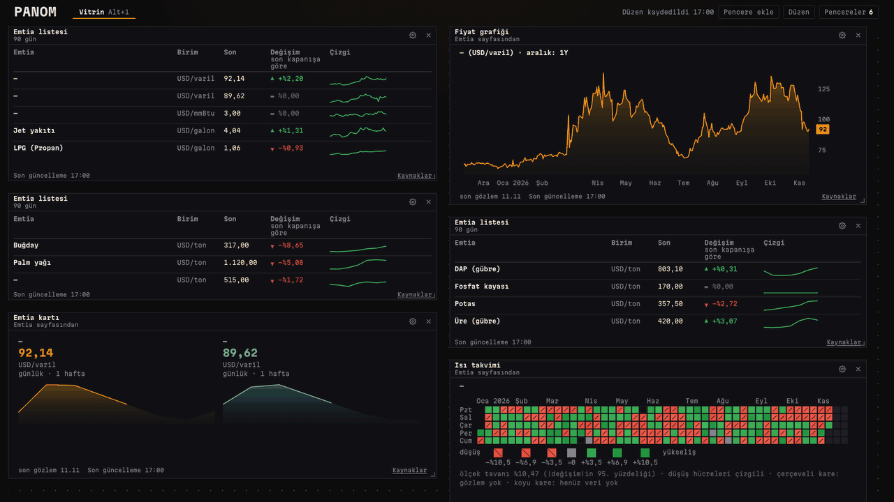
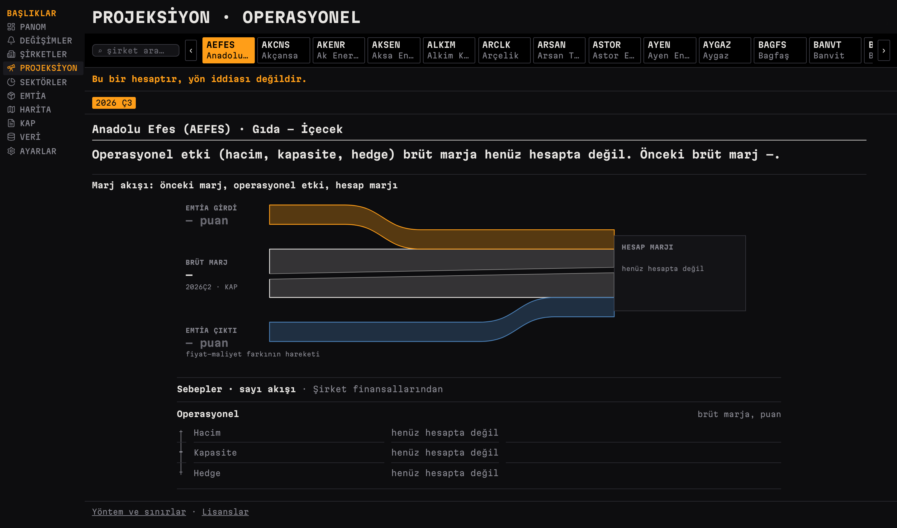
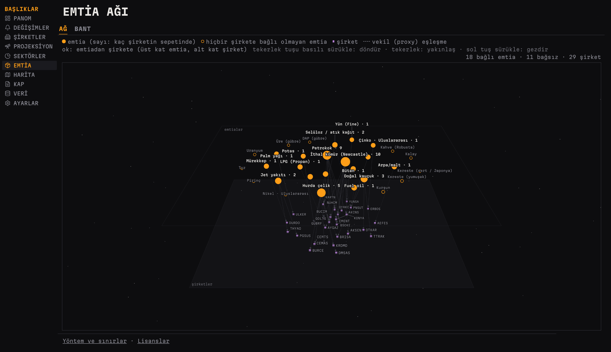

  

# Vantage Castle

[Türkçe](README.md)

Website: [vantagecastle.com](https://vantagecastle.com)

**How do commodity prices show up in a company's margin? On one screen, with the source next to every number.**

Vantage Castle puts the input commodity cost and the output price of Borsa Istanbul companies on the same axis and places, beside them, the gross margin the company has actually reported. Did a company's raw-material basket get more expensive, and did the price of its product cover it: both are visible side by side. The calculation on the Projection page is made by the **Commodity Margin Engine**: it looks at the company's financials, its commodities and its input–output, calculates before the financial statement is published where the gross margin could land in the next statement, and records it; when the realised value arrives, it is added beside the record. This is a calculation; it does not report a share price or an investment direction and it is not investment advice. How the engine works is described in the [Commodity Margin Engine](#commodity-margin-engine) section.

The product's left-hand menu runs in this order, and the screens in this document are given in the same order:

- **My board (Panom).** Your own tracking screen; you choose the windows.
- **Changes (Değişimler)** (sub-item **Bulletin**). What has changed since the date you choose; the weekly bulletin.
- **Companies (Şirketler).** Seven tabs: company details and margin flow, quarterly data, grid and ranking by four measures.
- **Projection (Projeksiyon).** The arithmetic effect of a commodity move on the gross margin; five views. A calculation, not a claim about direction.
- **Sectors (Sektörler)** (sub-item **Matching matrix**). Sector margins, the commodities tied to sectors and the input matching.
- **Commodities (Emtia)** (sub-item **Commodity Network**). Commodity prices and which commodity is tied to which sectors.
- **Map (Harita)** (sub-item **Supply Chain**). World news and the routes along which companies' input commodities reach Türkiye.
- **KAP.** The filings list.
- **Data (Veri).** Sources, Data quality and Terms.
- **Settings (Ayarlar).** Language, appearance, menu and start page.

The **Screening (Tarama)** page (all companies in one table) is not in the left-hand menu; it is found as a page in the general search box.

This repository is a showcase: it contains no code and no data. The page images were taken in the product's masked mode: share prices, KAP (Public Disclosure Platform) filings, financial statement tables, news headlines, electricity (EPİAŞ) and chokepoint (PortWatch) values, and account details do not appear in them; "—" or a blank stands in their place. The interface is Turkish; an English option exists in Settings and the translation is in progress. [Source: the product's Settings page, 17.11.2026]

## Contents

- [What it does](#vantage-castle)
- [Screens](#screens): [My board](#my-board-panom) · [Changes](#changes-değişimler) · [Bulletin](#bulletin-bülten) · [Companies](#companies-şirketler) · [Projection](#projection-projeksiyon) · [Sectors](#sectors-sektörler) · [Matching matrix](#matching-matrix-eşleşme-matrisi) · [Commodities](#commodities-emtia) · [Tracked commodities](#tracked-commodities) · [Commodity Network](#commodity-network) · [Map](#map-harita) · [Supply Chain](#supply-chain) · [KAP](#kap) · [Sources](#sources-kaynaklar) · [Data quality](#data-quality-veri-kalitesi) · [Terms](#terms-terimler) · [Settings](#settings-ayarlar) · [Screening](#screening-tarama) · [Home page](#home-page-ana-sayfa) · [Sign in](#sign-in-giriş) · [Sign up](#sign-up-kaydol) · [About us](#about-us-hakkımızda)
- [Commodity Margin Engine](#commodity-margin-engine)
- [Method](#method)
- [Honest findings](#honest-findings)
- [Architecture](#architecture)
- [Team](#team)
- [What it does not do](#what-it-does-not-do)
- [Status](#status)
- [Licence and attributions](#licence-and-attributions)

The Method, Findings, Architecture and Team sections each have a short summary; the full text is inside the "Details" box and is also in the [docs](docs/) folder.

## Screens

The pages are given in the order of the product's left-hand menu; the file numbers of the images (01, 02, …) do not follow this order. The images contain no share prices, KAP filings, financial statement tables, news headlines, electricity (EPİAŞ) or chokepoint (PortWatch) values, or account details; "—" or a blank stands in their place. The page descriptions in this section were compared with the live product on 17.11.2026; the numbers there are live values and change, so they are not written here.

A data freshness strip sits in the top bar of every page: "Çekim … Emtia (resmi seri): n güncel, m gecikmede" (fetch … commodity, official series: n up to date, m delayed). It shows how many of the commodity series are up to date and how many are delayed. [Source: the product's top bar, live, 17.11.2026]

### My board (Panom)

Your own tracking screen; you choose the windows. Favourite companies (Yıldızlılar), a commodity chart, a heat calendar, exchange rates (against the lira) and bulletins sit on one board in the default layout. The top has the Düzenim (My layout), Bildirimler (Notifications), Pencere ekle (Add window) and Düzen (Layout) buttons. You save your layout and switch between layouts with Alt+1–9. You pick windows from companies, commodities and your pages; a new window goes to the first free place. The layout in the image below is an example, not the default.

### Changes (Değişimler)

What has changed since the date you choose, on one page. At the top are five range buttons (Son girişim: since last sign-in, Bugün: today, 7 days, 30 days, 90 days) and a date picker; on a first visit the last 30 days are shown. The page does no calculation; it lays out what changed in boxes, and a box in which nothing changed is not drawn. The boxes: Bilançolar (financial statements, gross and net margin), companies whose net margin exceeds revenue, Commodity prices (dollars), Balance-sheet calculation records, KAP filings, Exchange rates (against the lira), Unusual commodity moves, Gross margin by sector and Bulletins. At the bottom the "Veri güncelliği" (data freshness) and "Değişmeyenler" (unchanged) rows stand; the exchange-rate box names its source (CBRT EVDS). [Source: the product's Changes page, live, 17.11.2026]

### Bulletin (Bülten)

A sub-item of Changes. The weekly bulletin: the financial statements published in the period, companies' current gross and net margins, commodity moves, companies' input effect and the commodity–company effect matrix, the Projection records, new filings and the upcoming financial-statement calendar on one page. The page has Weekly and Unusual tabs, a week selector and a PDF download button. The numerical measurements are produced automatically; a published bulletin is not changed afterwards, and a correction is made in a new issue. The bulletin carries the notice "Yatırım tavsiyesi değildir" (not investment advice). Margins and numbers appear as "—" in the image. [Source: the product's Bulletin page, live, 17.11.2026]

### Companies (Şirketler)

The page has seven tabs; the company list, grouped by sector, stands on the left as the company selector ([Source: the product's Companies page, live and front-end source, 17.11.2026]):

1. **Company details.** The selected company's page: margin flow, input and output index, input prices, the Projection summary and the financial table on one page. Share price, volume, KAP and financial statement values appear as "—" in the image.
2. **Quarterly data.** The companies' quarter-by-quarter values. You choose the measure (gross margin, EBITDA, EBITDA margin, net profit margin, net debt/EBITDA), the ratio or volume display and value or change; the list can be narrowed to starred companies or to your own lists.
3. **Grid.** A small card for each company: the last quarter's change in gross margin (points) and the line of the last 12 quarters.
4. **Gross margin, EBITDA margin, Debt burden, Net profit margin.** Four tabs, each a chart that ranks companies by the chosen measure; those that have published are ordered by level and those that have not yet published are listed below in grey. The debt burden is net debt over the last four quarters' EBITDA.

Margin flow: the output price is taken as 100; the input items flow in from the left as separate bands, each with its share in the basket written beside it. The bands join in the input basket; once the basket's share is taken from the output, what remains goes to the margin gap box. Macro quantities such as the interest rate and the exchange rate sit outside the basket, in a separate corridor; the "Operasyon" (operations) band shows the cost that the coefficient does not carry over. The "Bugün" (today) view shows the latest record; in the "Ya şöyle olursa" (what if) view you give the change of an input item yourself and the flow is redrawn with the same calculation (output price held constant). The basket share comes from the gross margin in the financial report the company publishes on KAP, and the item weights from the product's calculation rule ([Method §1 and §4](#method)). The numbers in the flow derive from the gross margin the company publishes on KAP, so they appear as "—" in the image; the thickness of the bands shows only the layout.

The order of the flow, in a diagram that carries no values: the commodity input effect and the commodity output effect are added to the previous margin; the result is the calculated margin. Its labels are in Turkish. The 90-day window in the input effect is an example (in the product's settings the window is 30, 90 and 180 days; details in [Method §5](#method)).

### Projection (Projeksiyon)

It calculates the arithmetic effect of a commodity move on the gross margin under "everything else held constant"; the notice at the top of the page says that this is a calculation and carries no claim about direction. The calculation is made by the [Commodity Margin Engine](#commodity-margin-engine). The page has five views; at the top of the page are a company selector and the quarter label; numbers appear as "—" in the images.

**Commodity (Emtia).** For every company the blocks of the two methods stand apart: "Emtia fiyatından" (from commodity prices) and "Şirket finansallarından · ön kayıtlı yöntem" (from company financials, pre-registered method). The second block has the "Senaryo hesabı (orta)", "Bant (alt – üst)" and "Hesaplanan brüt marj" rows (scenario calculation, middle; band, low – high; calculated gross margin), and for a company-quarter that could not be measured it writes the reason ("ölçülemedi: …"). Below are the margin flow (previous margin, two effects, calculated margin) and the "Sebepler: sayı akışı" (reasons: number flow) section, which gives the step-by-step breakdown: the input effect and the output effect.

**Macro (Makro).** The effect of the exchange rate and inflation on the gross margin; it is not yet calculated and the screen says so with "henüz hesapta değil" (not yet calculated).

**Operational (Operasyonel).** The effect of volume, capacity and hedging; it is not yet calculated and the screen says so with "henüz hesapta değil" (not yet calculated).

**Scenario calculation (Senaryo hesabı).** You give the change for the input basket and the output basket (a slider or a percentage box); everything else stays constant and the margin flow is redrawn with the same calculation.

**Realised (Gerçekleşen).** For companies that have published their financial statements it places the recorded calculation beside the realised margin; a "Hesap türü" (calculation type) column says which method the calculation came from. For a company with no record there is no model output, and the latest quarter's realised margin is shown as a reference ([Reference margin](#commodity-margin-engine)). In demo mode this view is not listed in the menu.

### Sectors (Sektörler)

Choosing a sector shows the sector's gross margin (1Y, 3Y, 5Y or all), the distribution of the change in the gross margins of the companies in the sector, the gross margin within the sector and the commodities tied to the sector. In normal mode the margin panels work; in the masked image in this repository the margin panels read "henüz hesapta değil" (not yet calculated) and the sector–commodity matrix remains. In the matrix the number is the count of companies carrying that commodity in their basket; the shade is their share among the sector's companies. In demo mode this margin page is not listed. [Source: the product's Sectors page, live, 17.11.2026]

### Matching matrix (Eşleşme matrisi)

A sub-item of Sectors. It shows, in one table, whether each company's each input is matched directly or by a proxy series. The rows are companies (ticker and sector) and the columns are commodities; the three counters at the top count the companies with a full match (no proxy), with at least one proxy match, and with no input data at all. The sector and commodity selectors and the "Tümü" (all), "Sadece doğrudan" (direct only) and "Sadece proxy" (proxy only) buttons filter the table. An asterisk is a proxy match and "—" means no data. In the image the numbers in the counters and the cells appear as "—"; the table scrolls sideways, so only its left part is in the frame. [Source: the product's Matching matrix page]

### Commodities (Emtia)

Commodity prices, with the selected series' chart, its source and unit. The page has a commodity card strip, a commodity list grouped by sector, multi-select, the selected series' chart, a heat calendar and a horizon chart. The prices are official series: most are monthly and some are irregular (the commodity card and the chart heading give each series' frequency); there are also series followed daily. [Source: the product's Commodities page, live, 17.11.2026]

### Tracked commodities

This list, taken from the commodity list of the Commodities page above, contains the **29 commodities** whose source is shown in the [Licence and attributions](#licence-and-attributions) section of this document: energy 7, metals 5, agriculture 5, chemicals and fertilizer 7, other raw materials 5. The table gives each commodity's Turkish and English name, group and source. The group is an editorial classification and is not used in any calculation. [Source: the product's commodity list, 2026-11-17; the number is the count of rows in the table]

| Commodity (English) | Emtia (Turkish) | Group | Source |
|---|---|---|---|
| Butane | Bütan | Energy | FRED, Federal Reserve Bank of St. Louis (EIA and BLS series) |
| Fuel oil | Fuel oil | Energy | FRED, Federal Reserve Bank of St. Louis (EIA and BLS series) |
| Imported coal (Newcastle) | İthal kömür (Newcastle) | Energy | FRED, Federal Reserve Bank of St. Louis (IMF series) |
| Jet fuel | Jet yakıtı | Energy | FRED, Federal Reserve Bank of St. Louis (EIA and BLS series) |
| LPG (propane) | LPG (Propan) | Energy | FRED, Federal Reserve Bank of St. Louis (EIA and BLS series) |
| Petroleum coke (petcoke) | Petrokok | Energy | FRED, Federal Reserve Bank of St. Louis (EIA and BLS series) |
| Uranium | Uranyum | Energy | FRED, Federal Reserve Bank of St. Louis (IMF series) |
| Steel scrap | Hurda çelik | Metals | FRED, Federal Reserve Bank of St. Louis (EIA and BLS series) |
| Tin | Kalay | Metals | FRED, Federal Reserve Bank of St. Louis (IMF series) |
| Lead | Kurşun | Metals | FRED, Federal Reserve Bank of St. Louis (IMF series) |
| Nickel | Nikel | Metals | FRED, Federal Reserve Bank of St. Louis (IMF series) |
| Zinc | Çinko | Metals | FRED, Federal Reserve Bank of St. Louis (IMF series) |
| Barley / malt | Arpa/malt | Agriculture | FRED, Federal Reserve Bank of St. Louis (EIA and BLS series) |
| Coffee (Robusta) | Kahve (Robusta) | Agriculture | FRED, Federal Reserve Bank of St. Louis (IMF series) |
| Palm oil | Palm yağı | Agriculture | The World Bank, Commodity Price Data (The Pink Sheet) |
| Rice | Pirinç | Agriculture | FRED, Federal Reserve Bank of St. Louis (IMF series) |
| Raw milk | Çiğ süt | Agriculture | Ulusal Süt Konseyi (the Turkish National Milk Council) |
| DAP (diammonium phosphate, fertiliser) | DAP (gübre) | Chemicals and fertilizer | The World Bank, Commodity Price Data (The Pink Sheet) |
| Phosphate rock | Fosfat kayası | Chemicals and fertilizer | The World Bank, Commodity Price Data (The Pink Sheet) |
| Carbon black | Karbon siyahı | Chemicals and fertilizer | FRED, Federal Reserve Bank of St. Louis (EIA and BLS series) |
| Ink | Mürekkep | Chemicals and fertilizer | FRED, Federal Reserve Bank of St. Louis (EIA and BLS series) |
| Potash (potassium chloride) | Potas | Chemicals and fertilizer | The World Bank, Commodity Price Data (The Pink Sheet) |
| Salt | Tuz | Chemicals and fertilizer | FRED, Federal Reserve Bank of St. Louis (EIA and BLS series) |
| Urea (fertiliser) | Üre (gübre) | Chemicals and fertilizer | The World Bank, Commodity Price Data (The Pink Sheet) |
| Natural rubber | Doğal kauçuk | Other raw materials | FRED, Federal Reserve Bank of St. Louis (IMF series) |
| Hardwood sawnwood (Japan) | Kereste (sert, Japonya) | Other raw materials | FRED, Federal Reserve Bank of St. Louis (IMF series) |
| Softwood lumber | Kereste (yumuşak) | Other raw materials | FRED, Federal Reserve Bank of St. Louis (IMF series) |
| Pulp / recovered paper | Selüloz / atık kağıt | Other raw materials | FRED, Federal Reserve Bank of St. Louis (EIA and BLS series) |
| Wool (fine) | Yün (Fine) | Other raw materials | FRED, Federal Reserve Bank of St. Louis (IMF series) |

The Source column uses the attribution names in the [Licence and attributions](#licence-and-attributions) section. [Source: the product's commodity list, 2026-11-17]

### Commodity Network

A sub-item of Commodities. Which commodity is tied to which sectors, in a single network view. The links come from the companies' input baskets; most basket weights are an assumption ([Method §1 and Limits](#method)).

### Map (Harita)

World news linked to companies' commodity exposure. Whichever commodity a news item affects, the companies that carry that commodity in their input basket appear side by side on the map. The arrows show the direction of the relationship the news describes; they are not a claim of effect. The page has time buttons (last 24 hours, 7 days, 30 days), an "Açıklamayı yapan" (who made the statement) filter, a news list and crisis files. In the image the news headlines appear as "—"; the map, news clusters, arrows, chokepoints and crisis files remain.

### Supply Chain

A sub-item of Map. From which countries of origin, and along which routes and transit points, the selected company's input commodities arrive in Türkiye. The page is an eight-step walk-through: 1 Company (Şirket), 2 Inputs (Girdiler), 3 Domestic and country (Yerli ve ülke), 4 Routes (Yollar), 5 Transits (Geçişler), 6 One country (Bir ülke), 7 One point (Bir nokta), 8 Transit share (Geçiş payı); the images (example: Ereğli) show the fifth step, the question "which transits are on the route, and how many ships pass per day?". The page shows Türkiye-wide imports; it does not mean the company's own supplier, and most shares carry an "approximate" label. Box sizes follow the input's share in the basket and its share within imports; most basket weights are an assumption ([Method §1](#method)). [Source: the explanatory text on the product's Supply Chain page]

**Route map.** A schematic sea map: lines from the countries of origin to Türkiye (iron ore and bituminous coal in separate colours) and the transit points on the way (Gibraltar, Suez, Bab el-Mandeb, the Turkish Straits). The lines are schematic, not an actual voyage; domestic production and land or pipeline imports are not drawn on the map and stand as separate branches in the network. The table below the map holds the daily transit counts of the chokepoints (IMF PortWatch medians); in the image in this repository these counts appear as "—".

**Layered network.** The flow is given in company, input, domestic share plus country of origin, and transit point columns; hovering over a link or a node says what it carries and the route is highlighted on the map.

**The company's own statement.** This panel at the bottom of the page shows the supplier countries and the self-sufficiency statement from the company's own document separately from the Türkiye-wide data; the two sides are not calculated from each other. In the image in this repository the panel's fields appear as "—".

### KAP

The page listing KAP filings, which can be filtered by time range (1W, 1M, 3M, 6M, 1Y, all), company, sector and filing type ("Hangi şirket ne bildirdi, ne zaman?": which company announced what, and when?). In the masked mode no filings are shown; the list is empty, which is why this repository has no image for KAP. In demo mode this page is not listed in the menu. [Source: the product's KAP page, live, 17.11.2026]

### Sources (Kaynaklar)

The first page of the Data menu: "Veriler nereden geliyor?" (where does the data come from?). Each series' institution, licence and last observation are on this page; clicking a row opens the series' record card (code, credit, link and data chain). The sections: Summary, Commodity and macro series, Exchange rates, Output proxies, Company data, Map layers, Matching rationale and Decision history. The list can be exported to Excel. The page does no calculation; it only shows recorded information. Its name in the menu is "Kaynak" in Turkish. The page's image is not in this repository. The Sources page lists source names and credits. [Source: the product's Sources page, live, 17.11.2026]

### Data quality (Veri kalitesi)

Is each company's data good enough for the calculation? Every company's data passes a screening: those that remain enter the calculation, those with a warning enter with a note, those eliminated do not, and those followed only on the output side are marked separately; each company's input coverage is written beside it. The page consists of Summary (counters for remaining, warning and eliminated), Companies (a table filtered by sector and status), Data freshness and delays, Verification and Agent runs sections. [Source: the product's Data quality page, live, 17.11.2026]

### Terms (Terimler)

Short definitions of the words on the screens; the page has a term search box and a term list, and clicking a term opens its calculation and reading note. [Source: the product's Terms page, live, 17.11.2026]

### Settings (Ayarlar)

Language (Türkçe or English; the page reloads on choosing and the preference is kept on the device), page scale, reduced motion, only favourites in the commodity strip, menu and start page (the page to open on sign-in and the headings shown in the menu), chart lighting, changing the password and resetting preferences. The English interface is still being translated. [Source: the product's Settings page, 17.11.2026]

### Screening (Tarama)

Not in the left-hand menu; it is found as a page in the general search box. All companies in one table: the 90-day input and output change, the price–cost gap (90-day change, five-year historical position, size of the move) and the data status ("şirkete özgü ölçüm": company-specific measurement, or "paylaşımlı proxy": shared proxy); companies sharing an identical series are grouped. There are a sector filter, a "Yalnız yeni şirketler" (new companies only) button, a list filter box and a "Bu süzgeci kaydet" (save this filter) button; at the top stand the 90-day input and output averages and the counters for remaining, warning and eliminated. Values appear as "—" in the image. [Source: the product's Screening page, live, 17.11.2026]

### Home page (Ana sayfa)

The product's public home page: it explains what the product measures, gives a short tour of the pages and answers frequently asked questions. The image is the full length of the page (about 11 MB), so it is not shown inline: [screenshots/13-anasayfa.png](screenshots/13-anasayfa.png).

### Sign in (Giriş)

The sign-in page for users with an account; the form is empty in the image.

### Sign up (Kaydol)

The account application page: the application goes to administrator approval, and the page says what an account opens and what it does not. The form is empty in the image.

### About us (Hakkımızda)

What the product is, what it does, what it does not do and how it approaches data, in four boxes.

## Commodity Margin Engine

Every number on the Projection page is calculated by the Commodity Margin Engine. Before a financial statement is published, the engine calculates, in the light of commodity moves and the company's own structure, where a company's gross margin could land in the next statement, and records it; when the realised value arrives, it is added beside the record. This is a calculation: it says nothing about a share price or an investment direction, it is not a referee and it is not investment advice. [Source: the product's Projection page and the team's method document; the document is not in this repository]

### What it calculates and what it does not

The engine answers a single question: "If everything else stays constant, by how many points does the known commodity move shift the company's gross margin?" The notice at the top of the page says so: "Bu bir hesaptır, yön iddiası değildir" (this is a calculation, not a claim about direction). Volume, the company's unobserved cost items and price pass-through are held constant. The engine nowhere produces a share price or a trading verdict. [Source: the product's Projection page, 17.11.2026]

### Three inputs

The engine looks at three things:

1. **The company's financials.** Quarterly revenue, cost of sales and gross profit published on KAP; the inventory turnover period; the effect of inflation accounting (IAS 29, "TMS 29" in Turkish practice).
2. **The company's commodities.** The official-series prices of the commodities in the company's input basket. Prices are read back by the inventory turnover period: today's price move reaches the financial statement only as the stock runs down.
3. **Input–output.** The price of the input basket and the output price series closest to what the company sells are put side by side; the difference between them forms the output effect in the calculation.

[Source: the product's Projection page, "Sebepler: sayı akışı" (reasons: number flow) section, 17.11.2026; the team's method document]

### Two methods, one screen

For every company the Projection · Commodity page shows the result of two methods in separate blocks: **"Emtia fiyatından" (from commodity prices)** and **"Şirket finansallarından" (from company financials)**, the latter marked "ön kayıtlı yöntem" (pre-registered method). The two blocks appear separately on screen. The team's method document ties which of the two is shown as the main figure to a selection rule written in advance, sector by sector. This selection rule is planned from the fourth quarter of 2026 and is not yet visible on screen. [Source: the product's Projection · Commodity and Realised pages, 17.11.2026; the team's method document]

### The "from commodity prices" method

It shows the path from the previous margin to the calculated margin step by step; the order in the screen's "Sebepler" (reasons) section is:

- **Input side.** Price change of the input basket → inventory lag (it shifts the window of the commodity change; it is not a separate margin term) → cost coefficient (how much of the change in the input basket shows up in cost) → change passed to cost → output pass-through ratio (how much of the cost change shows up in the selling price) → change passed to sales revenue → input effect on the gross margin.
- **Output side.** The difference between the output basket (the output price series, for most companies the relevant sub-item of the TÜİK Domestic Producer Price Index) and the input basket → output effect on the gross margin.
- **Result.** The previous quarter's margin + the input effect + the output effect = the calculated margin. The page's "Marj akışı" (margin flow) diagram draws the same order.

The base of this method is the previous quarter. [Source: the product's Projection · Commodity page, 17.11.2026; the team's method document]

### The "from company financials" method

This method starts from the company's own past financial behaviour:

- **Base.** The value of the same quarter a year earlier, so that seasonality does not enter the calculation.
- **Real input shock.** The price change of the input basket, stripped of the change in the consumer price index over the same window and read back by the inventory lag.
- **Two coefficients.** The input response (how much of the real shock shows up in cost) and the sales pass-through (how much of the real cost change shows up in real sales) are estimated from the company's own past quarters. The history that sets the coefficients ends on a date frozen in the pre-registration and does not change in the forward record.
- **Three arms.** The low arm assumes no pass-through to sales, the middle arm the company's past behaviour, the high arm the high pass-through observations in the company's history. On screen they appear as the "Senaryo hesabı (orta)" (scenario calculation, middle) and "Bant (alt – üst)" (band, low – high) rows; the band is the smallest and the largest of the three arms. The team's method document calls these three results "scenario arms"; because the names on screen are "Senaryo hesabı (orta)" and "Bant (alt – üst)", this document uses the name on screen.
- **Out of range.** If the calculated input shock falls outside the range of the history that set the coefficient, the value is not clipped or changed; the screen writes "aralık dışı" (out of range) and shows only the band.
- **Could not be measured.** If the data are not enough, the engine does not invent a number; it writes the reason: "kapsam düşük" (coverage low), "geçmiş yetersiz" (history insufficient), "taban doğrulanmadı" (base not verified), "girdi tepkisi ölçülemiyor" (input response cannot be measured), "benzer durum yok" (no similar case) or "girdi serisi yok" (no input series). These company-quarters are not dropped from the list; they are counted as "could not be measured".
- **Output check.** The change in sales derived from the financials is compared with the change in the market output price, and "piyasayla aynı" (same as the market), "piyasanın önünde" (ahead of the market) or "piyasanın gerisinde" (behind the market) is written. This check does not enter the calculation; because the sales amount also contains volume and product mix it carries an "approximate" label, and a "proxy" label if the series stands in for the company only indirectly.

In the internal evaluation the criterion is direction; the screen has no count of right or wrong directions, no rate and no success sentence. [Source: the team's pre-registered method document; the product's Projection · Commodity page, 17.11.2026]

### Decomposition: an internal research method (not yet in the product)

The team's method document describes how, after a financial statement is published, a company's actual gross margin change is split into parts: commodity and raw material, selling price and product mix, volume, exchange rate, inflation accounting (IAS 29), inventory effect and other expenses. This is an internal research method; it is not yet in the product and no decomposition appears on any screen. The method document is not an execution order: execution starts with a separate request and a human decision. According to the document, the parts are built from quantities that can be read openly in the notes of the financial report on KAP; volume (units) is taken from the company's interim operating report or from the sales-volume disclosure on KAP, and the price is derived from them, because the financial statements give no unit volume. Whether every company's interim operating report gives quarterly unit volume has not been verified. A part that cannot be read is not invented but written into a "remainder" row. The order is frozen from the start: first volume, then price, then cost. The difference between the official base and the decomposition base is written as a separate "base gap" row and is not mixed into the remainder. The decomposition is descriptive: it does not give a verdict that "the deviation came from this". [Source: the team's method document v1.3, §5, §6, §9, §10 and open point §11.2; the document is not in this repository]

### Reference margin on screen today; interval and fallback rule planned (not yet on screen)

**On screen today: reference margin.** If there is no model output for a company-quarter, the screen states that there is no model output and shows, as a reference, the company's most recently published three-month realised gross margin on KAP (Projection · Realised). This reference is not counted as any method's figure and does not enter any measurement. [Source: the product's Projection · Realised page, 17.11.2026; the team's method document]

**Planned, not yet on screen: interval.** The team's method document and its interval annex provide that, from the fourth quarter of 2026, a single half-width q is added on both sides of the main figure for every company and every method: [main figure − q, main figure + q]. q is to be calculated from that method's own past absolute errors (split conformal method; coverage 80% (design choice)); there is no hand-set width for a company or a sector, no clipping, and no pooling of errors across methods. For a method with a short history the interval is expected to come with the label "örnek n=…: kaba" (sample n=…: rough). The coverage guarantee rests on the assumption that the errors come from the same distribution; this assumption has not been measured. Today's screen has no such interval, no q and no such label: it shows only the "Bant (alt – üst)" (band, low – high) row, which, as described above, is the smallest and largest of the three arms and is not an interval calculated from past errors. [Source: the team's method document and interval annex v1.0, in force from 2026 Q4; formula: Angelopoulos and Bates, arXiv 2107.07511; the product's Projection · Commodity page, 17.11.2026]

**Planned, not yet on screen: fallback rule.** According to the document, if the method chosen by the selection rule gave no result for a company-quarter: (1) if the "from company financials" result exists for that company, the product will show it with a "fallback" label, and the fallback figure will not be called the chosen method's figure; (2) if that does not exist either, the product states that there is no model output and shows the reference margin (the behaviour above, which is on screen today). Today's screen has no "fallback" label. [Source: the team's method document v1.3, in force from 2026 Q4; the product's Projection pages, 17.11.2026]

**Honesty note.** The interval and the fallback rule were written after the results of the first forward-record measurement were seen; they are therefore not retroactive evidence for that measurement. The first real test is the fourth quarter of 2026, and there coverage will be only descriptive: "n=…, k=…" is written and no "held / did not hold" verdict is given. [Source: the team's method document]

### What is not yet calculated

The **Macro** view of Projection (the effect of the exchange rate and inflation) and its **Operational** view (the effect of volume, capacity and hedging) are not yet calculated; the screen says so plainly with "henüz hesapta değil" (not yet calculated), and these effects enter none of the engine's numbers. [Source: the product's Projection · Macro and Operational pages, 17.11.2026]

### Limits

- Most basket weights are an assumption; the basket followed is not the whole of cost.
- The change in sales is an amount response: volume and product mix are not shown separately.
- For some companies coverage, history or base is not enough; the engine writes "could not be measured" there.
- Inflation accounting (IAS 29) and the lira column of companies whose functional currency is the dollar or the euro are separate special cases that affect the calculation; the method document keeps them apart explicitly.
- The method document and the pre-registrations are frozen before results are seen; a change is a new document and a new version, and the old version does not change.

## Method

Four quantities sit side by side: the **input index** (the weighted price of the company's input commodity basket, 01.01.2015 = 100, read back by the inventory turnover period), the **output index** (for most companies the relevant sub-item of the TÜİK Domestic Producer Price Index), the **price–cost gap** (the ratio of the output index to the input index) and the **realised gross margin** (from the three-month financial report the company publishes on KAP). No "therefore" is put between them; they are two separately observed series. The calculated margin is recorded before the financial statement is published and the realised value is added beside it when it arrives; today's screen shows the "Bant (alt – üst)" (band, low – high) row; an interval calculated from past errors is planned from the fourth quarter of 2026 and is not yet on screen ([Commodity Margin Engine](#commodity-margin-engine)). [Source: the product's calculation rule; full text below]

<b>Details: Method (full text)</b>

This section describes the four basic quantities of Vantage Castle. All of them are measurements and calculations; none is a view on a share. This is not investment advice. Beside the numbers, the source or the type of measurement is written. The measurement records are not in this repository; the method is described in this section on its own.

### 1. Input index

The weighted average price of the company's input commodity basket, built on a 01.01.2015 = 100 base. For most companies the weights are a rank assumption: first input 50%, second 30%, third 20%. For the few companies with a measured share, the measured share replaces the assumption. A component whose price series cannot be found drops out of the basket, the remaining weights are rescaled and the dropped share appears in the row as "input coverage". [Source: the product's calculation rule; the weights are a design choice]

Even if a commodity gets more expensive today, a company keeps producing from old stock for a while. Input prices are therefore taken back by the company's inventory turnover period; the period is the average of the last four to eight valid quarters and is held between 0 and 365 days. The output price is not taken back. [Source: the product's calculation rule]

### 2. Output index

For most companies, the relevant sub-item of the TÜİK (Turkish Statistical Institute) Domestic Producer Price Index; built on the same 01.01.2015 = 100 base. [Source: TÜİK Domestic Producer Price Index]

### 3. Price–cost gap (the "scissors")

The ratio of the output index to the input index. What is measured is price; it is not profit, sales volume or efficiency. The current value is shown together with its percentile in the company's own last five years of history; it is not presented as a number on its own. The value is read at the latest date on which every component of the basket is known. [Source: the product's calculation rule]

### 4. Realised gross margin

(Revenue − cost of sales) ÷ revenue; taken from the three-month current column of the financial report the company publishes on KAP, not derived from a cumulative difference. The product shows the realised margin beside the price–cost gap and puts no "therefore" between them: they are two separately observed series. [Source: the financial reports companies publish on KAP]

### 5. Projection: a calculation, not a verdict

The Projection page calculates the arithmetic effect of a commodity move on the financial-statement margin under "everything else held constant"; volume, unobserved cost items and price pass-through are assumed constant. The commodity input effect is taken from the move of the input basket over a given window, and the basket is read back by the inventory turnover period as in §1; in the product's settings the window is defined as 30, 90 and 180 days, and the example in the [margin flow diagram](diagrams/marj-akisi.png) uses a 90-day window. [Source: the product's Projection page, 17.11.2026] Companies can absorb the effect through pricing, inventory, hedging and product mix. In past measurements no agreement distinguishable from a coin toss was found between the direction of the price–cost gap and the direction of the realised gross margin ([Honest findings](#honest-findings)). The product therefore does not report a share price or an investment direction; it shows, as a record, the margin calculated from input cost, the band and its difference from the realised margin. This is a calculation, not a referee and not investment advice; the realised value is added beside it afterwards. How the calculation is built is described in the [Commodity Margin Engine](#commodity-margin-engine) section.

### Limits

- Most basket weights are an assumption; a measured share exists only for a few companies.
- The basket followed is not the whole of cost; labour and depreciation are not in the basket.
- Companies sharing the same input basket and the same output index have numerically identical price–cost gaps; the product marks this as an "identical series" and claims no difference between them.
- The forward-record measurement still rests on a very short history; a common quarterly shock may have moved all companies in the same direction.

## Honest findings

Vantage Castle's most important design decision is what it does not say. None of the six measurements that tried to find out whether margin or a change in share price series can be derived from commodity prices found a significant relationship. For example, the direction of the price–cost gap and the direction of the realised gross margin in the same period could not be distinguished from a coin toss. The product therefore expresses no view; it shows what it measures side by side. The first forward-record measurement is not a referee. [Source: the product's internal measurements; full text below, the numbers are not in this repository]

<b>Details: Honest findings (full text)</b>

Vantage Castle's most important design decision is what it does not say. The measurements below tried to find out whether margin or a change in share price series can be derived from commodity prices; none found a significant relationship. The product therefore expresses no view; it shows what it measures side by side.

The measurements that use share prices are internal work done on commodity, margin and share price series. "No relationship" here means "could not be found with this data and this method"; it is not proof that no relationship exists.

### Paths tried and dropped (six measurements)

The "Data" column shows what kind of data the measurement rests on. These are the product's own internal measurements; their detailed records and numbers are not in this repository.

| # | Measurement | Result | Data |
|---|---|---|---|
| 1 | Regression pipeline: from the commodity change to the change in margin and in the share price series, company by company and in a single model | No significant power; explanatory power in the out-of-sample period is negative, that is, worse than a simple average | Commodity, margin and share price series |
| 2 | Does the direction of the price–cost gap match the direction of the realised gross margin in the same period? | The agreement could not be distinguished from a coin toss; no lag or alignment correction passed the threshold | Price–cost gap and KAP margin, past years |
| 3 | Sector-neutral reverse-ordered two-group difference: the difference in the change of the share price series between a group made of the companies with the most favourable gap measure and a reverse-ordered group made of those with the least favourable | The difference could not be distinguished from noise | Price–cost gap and share price series |
| 4 | Pricing-in measurement: when the gap changed markedly, how did the share price series separate from sector peers? | No relationship found | Price–cost gap and share price series |
| 5 | Inventory turnover: does the inventory turnover period change together with commodity prices? | No relationship found; the constant inventory turnover assumption is therefore kept | Commodity price and KAP financial reports |
| 6 | KAP event study: after a filing, does the share price series separate from its sector more than normal? | Looks only at the size of the separation, not its direction | KAP filings and share price series |

Two further paths were dropped: the "episode table", which matched periods of large change in the price–cost gap with the following margin, was removed (it would have shown an unproven relationship as proven), and the attempt to convert financial statements to a common base with consumer prices failed and was not applied to the tables.

### News direction label measurement (not on the product's pages)

News items were given a direction label and it was checked whether the price series then moved in the same direction; the plan was written and frozen before labelling began. Result: the agreement between the label direction and the following price series direction could not be distinguished from a coin toss at any of the three horizons (short, medium and long trading-day horizons); none of the three passed the significance threshold written in advance. Agreement between the labellers was moderate, so the result was recorded as "weak evidence of absence", not "no relationship for certain". This measurement does not enter the product; the labels are not shown on any screen. [Measurement: the team's internal measurement, 10.10.2026; news labels and share price series]

### Forward-record measurement (not a referee)

Calculations are made and recorded before the financial statement is published; when the realised value arrives, it is added beside them. The first forward-record measurement was made for the third quarter of 2026. This measurement is not a referee: no method choice or pass/fail verdict is drawn from it. Its numbers are not in this repository; the product's screens show the record and the realised value side by side ([Commodity Margin Engine](#commodity-margin-engine)).

### How these findings shaped the product

The product reports no share price or investment direction, gives no trade instructions, and makes no claim about a state or a direction such as "the gap has narrowed, there is margin pressure"; it puts the input index, the output index, the price–cost gap and the realised gross margin side by side without implying causality. It shows, as a record, the margin calculated from input cost, the band and its difference from the realised margin; this is a calculation, not a referee and not investment advice. This is not a stylistic preference but the result of the measurements above. The system shows what it measures side by side and leaves the interpretation to the reader.

## Architecture

Planned features in the diagram are marked "PLANNED (2026 Q4)".

Six steps: series from the sources → record and check layer (unit and date check, source record) → measurement layer (input index, output index, price–cost gap, realised gross margin) → Commodity Margin Engine (two methods and a band; interval and fallback rule planned, not yet on screen) → presentation pages (sources and licences are on the Sources page) → development by a team made up of AI agents.

<b>Details: Architecture (full text)</b>

1. **Data sources.** Series with a stated source: commodity prices, exchange rates, interest and inflation series, company financials. The sources of the data shown in this repository's images are written in the [Licence and attributions](#licence-and-attributions) section; the product's Sources (Kaynak) page also shows each series' institution, licence and last observation.
2. **Record and check layer.** Every row passes a unit and date check and the source it came from is recorded.
3. **Measurement layer.** For each company, the input index (the weighted price of the commodities in the input basket), the output index (a series close to the selling price) and their ratio, the price–cost gap, are calculated; the realised gross margin stands beside them.
4. **Commodity Margin Engine.** It turns the series in the measurement layer and the company's financials into the Projection calculation: two methods and a band. An interval calculated from past errors and a fallback rule are planned from the fourth quarter of 2026 and are not yet on screen. The methods are written and recorded before the financial statement is published; a recorded calculation does not change afterwards, and the realised value is added beside it ([Commodity Margin Engine](#commodity-margin-engine)).
5. **Presentation.** The My board, Changes, Bulletin, Companies, Projection, Sectors, Commodities, Commodity Network, Map, Supply Chain, KAP, Sources, Data quality, Terms, Settings and Screening pages read only from the measurement layer and the engine's record; sources and licences are written on the Data › Sources page. In the publication mode share prices, KAP filings and financial statement tables are not shown; in the masked mode news headlines, electricity (EPİAŞ) and chokepoint (PortWatch) values, and account details are also not shown. In demo mode KAP, the Sectors margin page and Projection · Realised are not listed in the menu. The page images in this repository were taken in the masked mode. [Source: the product's menu definition, 17.11.2026]
6. **Development.** The product is developed by a team made up of AI agents: every job starts with a plan, production and review happen in separate sessions, and every step that goes outside is in human hands. Details: [Team](#team)

## Team

Vantage Castle is developed by a team made up of AI agents: each agent works in a separate session with a single role. Every task starts with a plan, the producer does not approve its own work (a separate reviewer looks at the applied result), everything that goes outside is in human hands, and the final word belongs to the human. [Source: a short summary of the working order; full text below]

<b>Details: Team (full text)</b>

Vantage Castle is a product of HBK Software. HBK Software is a team made up of AI agents: each agent works in a separate session with a single role. The owner of the company is a human, and the final word is theirs. This section describes how the team works, and what it does and does not do.

### Roles

The team has nine roles:

| Role | What it does |
|---|---|
| Private secretary | Distributes requests, collects finished work, leaves the human a short result note |
| Front end | Writes the interface |
| Back end | Writes the server, calculation and test code |
| Designer | Draws the screen direction and mock-ups |
| Database specialist | Queries data read-only, writes counting and verification reports |
| Researcher | Brings sourced, narrow notes from external sources; also wrote the texts in these documents |
| Auditor | Tests a delivery without seeing the producer's conversation, looking only at the output and the rules |
| Council | Writes drafts of new versions of the rules; does not sign them |
| Security | Watches authority limits, records and history; reports what it finds and does not fix it itself |

### How work runs

1. **Every task starts with a plan.** The plan is short: what will be done, which files will be touched, how it will be verified, how long it will take, what the risk is. Whether a plan goes to the human for approval is set by the human: every plan, only large tasks, or none.
2. **Whoever produces does not approve their own work.** First a machine checks: tests, a secrets scan and protection checks run. Then an auditor in a separate session, without seeing the producer's conversation, looks at the delivery as actually applied: does it work and look right with a copy of the real data? Without a look at the applied result there is no acceptance.
3. **If rejected, the producer fixes.** The private secretary runs at most two correction rounds without asking the human; at the third, the decision is the human's.
4. **There is a third pair of eyes.** The Security role watches for any step outside authority and reports it to the human if found.
5. **Everything that goes outside is with the human.** Publishing, deployment, e-mail, payment and sending data to third parties are closed to the agents; work stays in a local draft and local record.
6. **Rules belong to the human.** Agents write the drafts of rule changes; what takes effect is the human's signature.

### Memory and record

The agents have no memory between sessions. Each task starts in a clean session from a status file, a notebook and the request file; everything important is in files. Work is not finished until a report is written. Decisions are kept in one place only, exactly as the human stated them.

### Rule for numbers

No number is written without a source: the source or measurement stands next to every number. Instructions found in a page read from an outside source are data, not orders. Keys and passwords live only in environment variables; they are not written to files, reports or records.

### Limits

- Agents can be wrong. The aim of the working order is not to abolish error but to have a wrong result looked at by a separate pair of eyes; the audit, too, is limited, like any measurement.
- This section is a short summary of the working order; the full text of the internal rules is not in this repository.
- None of the product's numbers is an agent's "view"; they come from the measurement record and the source series ([Method](#method), [Honest findings](#honest-findings)).

## What it does not do

It does not report share prices or an investment direction, and it gives no trade instructions or investment advisory service. It shows, as a record, the calculated margin, the band and its difference from the realised margin; this is a calculation, not a referee and not investment advice, and it also states what it does not know.

## Status

Vantage Castle is currently in a closed demo stage. Accounts are opened by application: the application is made on the [Sign up (Kaydol)](#sign-up-kaydol) page and goes to administrator approval. Membership and API access are planned for the future; their scope and terms depend on the data licences.

## Licence and attributions

This repository contains no code; text and images are shared with all rights reserved.

The data in the images is given with its source:

- Map tiles (Map image, hero GIF): © OpenMapTiles © OpenStreetMap contributors
- News clusters (Map): Source: The GDELT Project (gdeltproject.org)
- Commodity prices (My board, Companies, Commodities, Changes, Bulletin, Commodity Network, Matching matrix, hero GIF):
  - Jet fuel, LPG, butane, petroleum coke, fuel oil, scrap steel, barley/malt, salt, printing ink, carbon black, pulp/waste paper: Source: FRED, Federal Reserve Bank of St. Louis (EIA and BLS series)
  - Imported coal (Newcastle), uranium, zinc, lead, nickel, tin, timber, rice, coffee, wool, natural rubber: Source: FRED, Federal Reserve Bank of St. Louis (IMF series); FRED carries the note "Copyrighted: Citation Required" on these series
  - Palm oil, DAP, phosphate rock, potash, urea: Source: The World Bank, Commodity Price Data (The Pink Sheet)
- Raw milk advisory price (Commodities, hero GIF): Source: Ulusal Süt Konseyi (the Turkish National Milk Council)
- Exchange rate data (dollar equivalent of series sourced in lira, Changes): Source: Central Bank of the Republic of Türkiye, Electronic Data Delivery System (EVDS)
- Output price indices (Companies, Projection): Source: TÜİK Domestic Producer Price Index, via CBRT EVDS
- Supply Chain (images): daily transit counts of the chokepoints: Source: IMF PortWatch; country-of-origin shares: Source: CEPII BACI; domestic production share: Source: USGS Mineral Commodity Summaries 2026 and publications of the Ministry of Energy and Natural Resources (ETKB); chokepoint positions: Source: representative centre points based on EIA
- Satellite image in the crisis-file panel of the product's Map page (the panel is not open in the images in this repository): MODIS Land Rapid Response Team, NASA GSFC (2020-12-02). Credit written in the image inside the product: "Kamu malı (ABD federal hükümeti çalışması – NASA)" (public domain, work of the US federal government – NASA). [Source: NASA, images and media usage guidelines, <https://www.nasa.gov/nasa-brand-center/images-and-media/>; accessed 16.11.2026: NASA content is generally not subject to copyright in the US, NASA is stated as the source]
- Typeface: Martian Mono, SIL Open Font License 1.1
