

  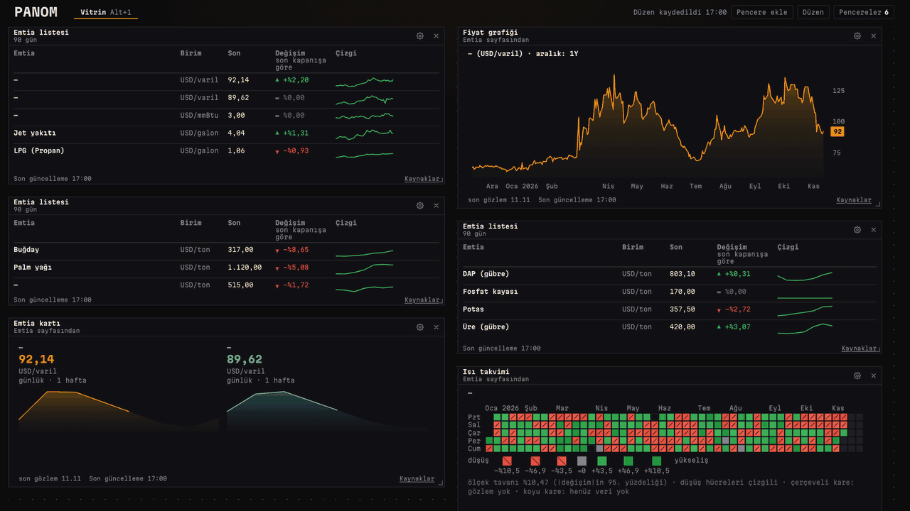

# Vantage Castle

[English](README.en.md)

**Emtia fiyatları bir şirketin marjına nasıl yansır? Tek ekranda, her sayının kaynağıyla.**

Vantage Castle, BIST şirketlerinin girdi emtia maliyetini çıktı fiyatıyla aynı eksene koyar ve yanına şirketin açıkladığı gerçekleşen brüt marjı yerleştirir. Bir şirketin hammadde sepeti pahalandı mı, sattığı ürünün fiyatı bunu karşıladı mı: ikisi yan yana görünür. Girdi maliyetinden hesaplanan marj ve aralık, bilanço açıklanmadan önce kayda geçirilir; gerçekleşen değer gelince yanına eklenir. Ölçüm böylece kayıtla sabitlenir.

- **Panom.** Kendi takip ekranınız; pencereleri siz seçersiniz.
- **Harita.** Dünya haberleri, şirketlerin emtia maruziyetine bağlanır.
- **Şirketler.** Marj akışı: girdi kalemleri, girdi sepeti ve marj farkı tek şemada.
- **Emtialar.** Emtia fiyatları, seçili serinin grafiği, kaynağı ve birimiyle.
- **Değişimler.** Seçtiğiniz tarihten beri ne değişti, tek sayfada.
- **Bülten.** Haftalık bülten: emtia hareketi, marjlar ve etki matrisi.
- **Projeksiyon.** Emtia hareketinin brüt marja aritmetik etkisi; bir hesaptır, yön iddiası değildir.
- **Sektörler.** Sektör marjları, sektöre bağlı emtialar ve girdi eşleşme matrisi.
- **Emtia Ağı.** Hangi emtia hangi sektörlerle bağlı.
- **Tedarik Zinciri.** Bir şirketin girdi emtialarının Türkiye'ye hangi ülkelerden, hangi güzergâh ve geçiş noktalarından geldiği (Türkiye geneli ithalat).
- **KAP, Veri kalitesi, Terimler, Tarama.** Bildirim listesi, şirket başına veri durumu, terim sözlüğü ve tüm şirketlerin tek tabloda taraması.

Bu depo bir vitrindir: kod ve veri içermez. Sayfa görüntüleri ürünün maskeli kipinde alınmıştır: hisse fiyatı, KAP bildirimleri, bilanço tabloları, haber başlıkları, elektrik (EPİAŞ) ve geçiş noktası (PortWatch) değerleri ile hesap bilgileri görüntüye girmez; yerinde "—" ya da boşluk durur. Arayüz Türkçedir.

## İçindekiler

- [Ne yapar](#vantage-castle)
- [Ekranlar](#ekranlar): [Panom](#panom) · [Harita](#harita) · [Şirketler](#şirketler) · [Emtialar](#emtialar) · [Değişimler](#değişimler) · [Bülten](#bülten) · [Projeksiyon](#projeksiyon) · [Sektörler](#sektörler) · [Eşleşme matrisi](#eşleşme-matrisi) · [Emtia Ağı](#emtia-ağı) · [Tedarik Zinciri](#tedarik-zinciri) · [KAP](#kap) · [Veri kalitesi](#veri-kalitesi) · [Terimler](#terimler) · [Ana sayfa](#ana-sayfa) · [Giriş](#giriş) · [Kaydol](#kaydol) · [Hakkımızda](#hakkımızda) · [Tarama](#tarama)
- [Yöntem](#yöntem)
- [Dürüst bulgular](#dürüst-bulgular)
- [Mimari](#mimari)
- [Ekip](#ekip)
- [Ne yapmaz](#ne-yapmaz)
- [Lisans ve atıflar](#lisans-ve-atıflar)

Yöntem, bulgular, mimari ve ekip bölümlerinde kısa bir özet vardır; tam metin "Ayrıntılar" kutusunun içindedir.

## Ekranlar

Sayfalar ürünün sol menüsündeki sırayla ve görüntülerin dosya numarasıyla (01, 02, …) verilir. Görüntülerde hisse fiyatı, KAP bildirimleri, bilanço tabloları, haber başlıkları, elektrik (EPİAŞ) ve geçiş noktası (PortWatch) değerleri ile hesap bilgileri bulunmaz; yerinde "—" ya da boşluk durur.

### Panom

Kendi takip ekranınız; pencereleri siz seçersiniz. Favori şirketler, emtia grafiği, ısı takvimi, kur ve bültenler tek panoda. Düzeninizi kaydedersiniz; Alt+1–9 ile düzenler arasında geçersiniz. Şirketlerden, emtialardan ve sayfalarınızdan pencere seçersiniz; yeni pencere ilk boş yere gelir.

### Harita

Dünya haberleri, şirketlerin emtia maruziyetine bağlanır. Bir haber hangi emtiayı etkiliyorsa, o emtiayı girdi sepetinde taşıyan şirketler haritada yan yana görünür. Oklar haberin anlattığı ilişkinin yönüdür; etki iddiası değildir. Görüntüde haber başlıkları yerine "—" görünür; harita, haber kümeleri, oklar, geçiş noktaları ve kriz dosyaları durur.

### Şirketler

Seçili şirketin sayfası: marj akışı, girdi ve çıktı endeksi, girdi fiyatları, Projeksiyon özeti ve mali tablo tek sayfada. Hisse fiyatı, hacim, KAP ve bilanço değerleri görüntüde "—" görünür.

Marj akışı: çıktının fiyatı 100 alınır; girdi kalemleri ayrı şeritler olarak soldan akar, her şeridin yanında sepet içindeki payı yazar. Şeritler girdi sepetinde birleşir, çıktıdan sepetin payı çıkınca kalan marj farkı kutusuna gider. Faiz ve kur gibi makro büyüklükler sepetin dışında ayrı bir koridorda durur. "Bugün" görünümü son kaydı gösterir; "Ya şöyle olursa" görünümünde bir girdi kaleminin değişimini siz verirsiniz ve akış aynı hesapla yeniden çizilir (çıktı fiyatı sabitken). Sepet payı şirketin KAP'ta yayımladığı finansal rapordaki brüt marjdan, kalem ağırlıkları ürünün hesap kuralından gelir ([Yöntem §1 ve §4](#yöntem)). Akıştaki sayılar şirketin KAP'ta yayımladığı brüt marjdan türediği için görüntüde "—" görünür; şeritlerin kalınlığı yalnız düzeni gösterir.

Akışın sırası, değer taşımayan bir şemada: önceki marja emtia girdi etkisi ve emtia çıktı etkisi eklenir, sonuç hesap marjıdır. Girdi etkisindeki 90 günlük pencere örnektir (ürünün ayarlarında pencere 30, 90 ve 180 gündür; ayrıntı [Yöntem §5](#yöntem)).

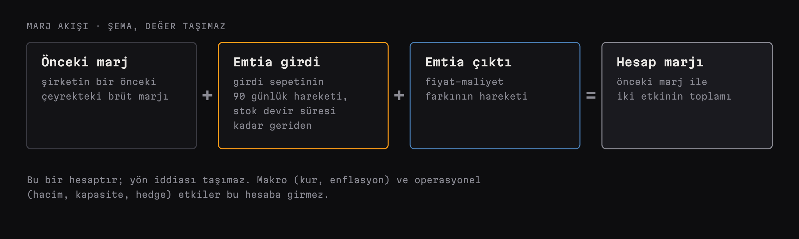

### Emtialar

Emtia fiyatları, seçili serinin grafiği, kaynağı ve birimiyle. Sayfada emtia kartı şeridi, emtia listesi, seçili serinin grafiği, ısı takvimi ve ufuk grafiği bulunur.

### Değişimler

Seçtiğiniz tarihten beri ne değişti. Emtia fiyatları, olağandışı hareketler, kur ve bültenler seçtiğiniz aralıkta tek sayfada; her satır kaynağına gider. Görüntü 90 günlük aralığı gösterir.

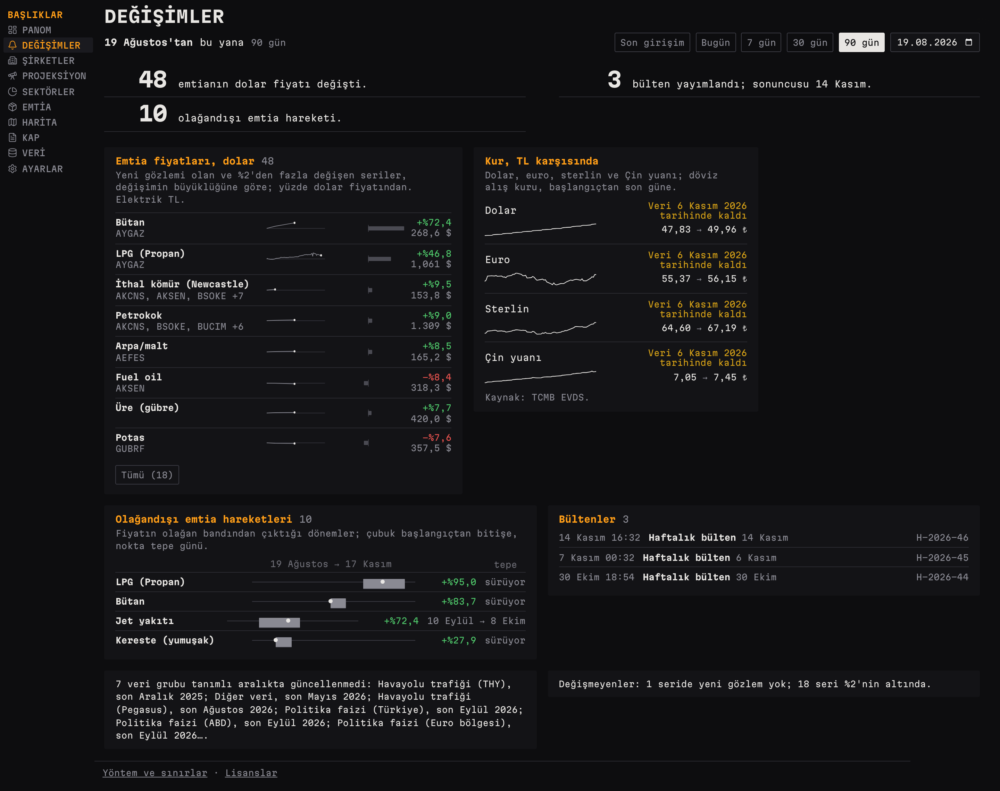

### Bülten

Haftalık bülten: emtia hareketi, açıklanan bilanço, şirketlerin brüt ve net marjı, emtia–şirket etki matrisi ve Projeksiyon kayıtları tek sayfada. Sayısal ölçümler otomatik üretilir; yayımlanan bülten sonradan değişmez, düzeltme yeni sayıyla yapılır. Görüntüde marjlar ve sayılar "—" görünür.

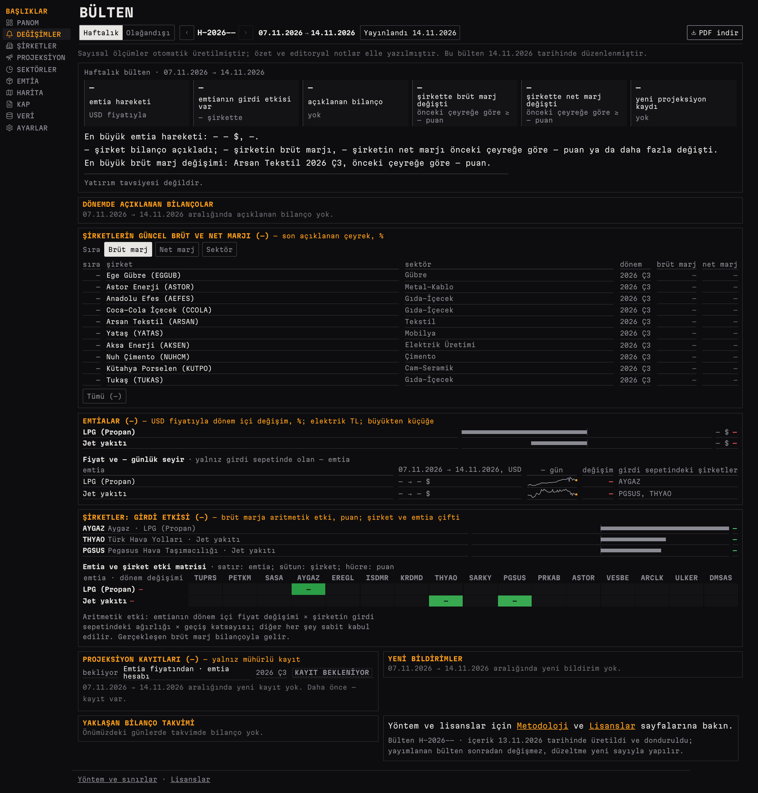

### Projeksiyon

Emtia hareketinin brüt marja aritmetik etkisini "diğer her şey sabit kalırsa" varsayımıyla hesaplar; sayfanın üstündeki uyarı bunun bir hesap olduğunu ve yön iddiası taşımadığını söyler ([Yöntem §5](#yöntem)). Sayfanın beş görünümü vardır; görüntülerde sayılar "—" görünür.

**Emtia.** Girdi ve çıktı tarafında emtia hareketinin marja etkisi adım adım; marj akışı önceki marjdan hesap marjına gider.

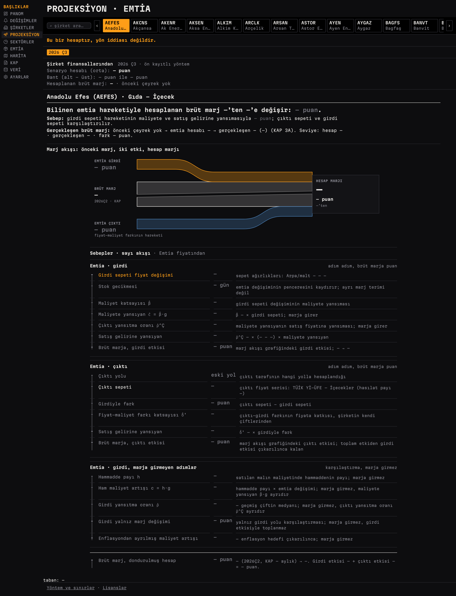

**Makro.** Kur ve enflasyonun brüt marja etkisi; görüntüde bu etkiler "henüz hesapta değil" der.

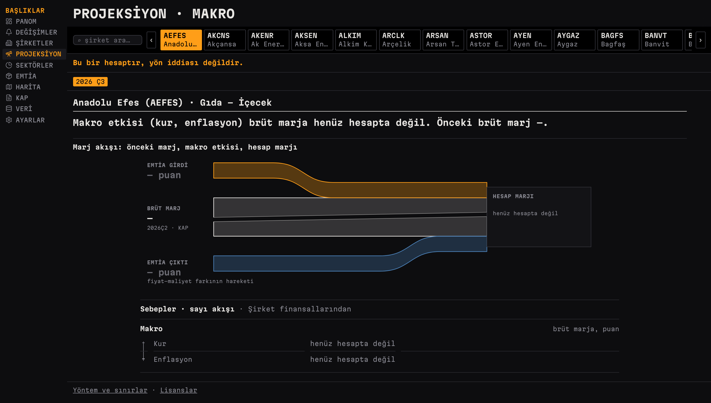

**Operasyonel.** Hacim, kapasite ve hedge etkisi; görüntüde bu etkiler "henüz hesapta değil" der.

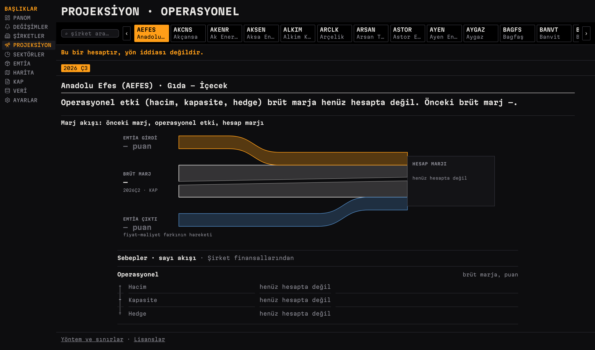

**Senaryo hesabı.** Girdi sepeti ve çıktı sepeti için değişimi siz verirsiniz (kaydırıcı ya da yüzde kutusu); diğer her şey sabit kalır ve marj akışı aynı hesapla yeniden çizilir.

**Gerçekleşen.** Bilanço açıklayan şirketlerde önceki kayıtlı hesabı gerçekleşen marjla yan yana koyar; kaydı olmayan şirkette model çıktısı yoktur ve referans olarak son çeyreğin gerçekleşen marjı gösterilir ([Yöntem §7](#yöntem)).

### Sektörler

Sektör seçilince sektör brüt marjı, sektördeki şirketlerin marj değişimi ve sektöre bağlı emtialar görülür; görüntüde marj grafikleri "henüz hesapta değil" der, sektör–emtia matrisi durur. Matriste sayı, o emtiayı sepetinde taşıyan şirket sayısıdır; koyuluk, sektördeki şirketlere oranıdır.

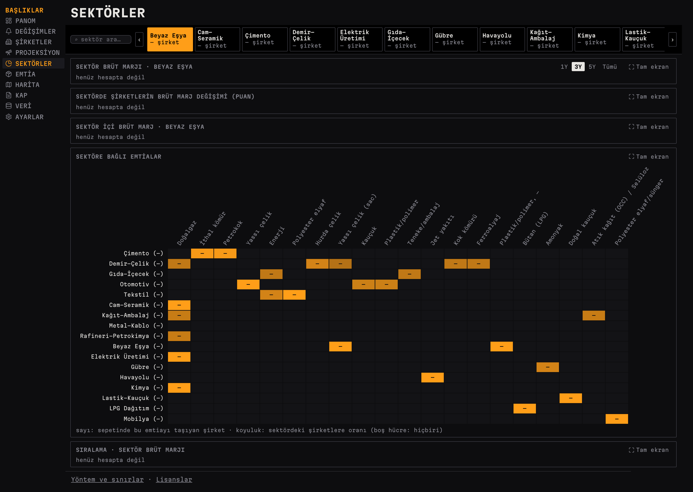

### Eşleşme matrisi

Her şirketin her girdisinin doğrudan mı, yoksa vekil (proxy) bir seriyle mi eşlendiğini tek tabloda gösterir. Satırlar şirketlerdir (borsa kodu ve sektör), sütunlar emtialardır; üstteki üç sayaç tam eşleşmiş (vekil yok), en az bir vekil eşleşmesi olan ve hiç girdi verisi bulunmayan şirketleri sayar. Sektör ve emtia seçicileri ile "Tümü", "Sadece doğrudan" ve "Sadece proxy" düğmeleri tabloyu süzer. Yıldız vekil eşleşme, "—" veri yok demektir. Görüntüde sayaçlardaki ve hücrelerdeki sayılar "—" görünür; tablo yatay kaydığı için karede yalnız sol kısmı vardır. [Kaynak: ürünün Eşleşme matrisi sayfası]

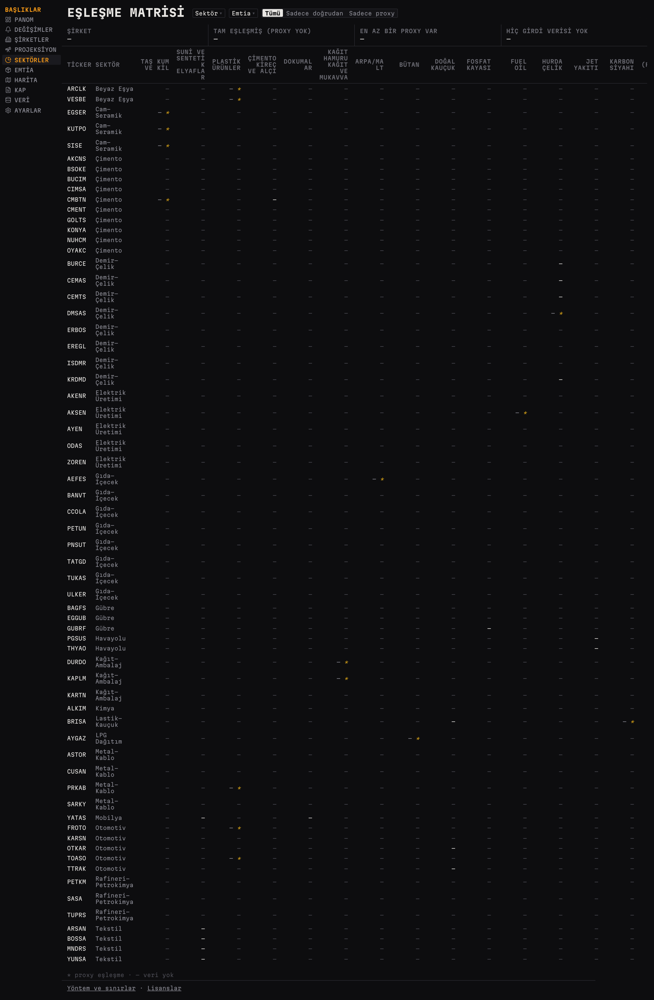

### Emtia Ağı

Hangi emtia hangi sektörlerle bağlı, tek ağ görüntüsünde. Bağlar şirketlerin girdi sepetinden gelir; sepet ağırlıklarının çoğu varsayımdır ([Yöntem §1](#yöntem) ve [Sınırlar](#yöntem)).

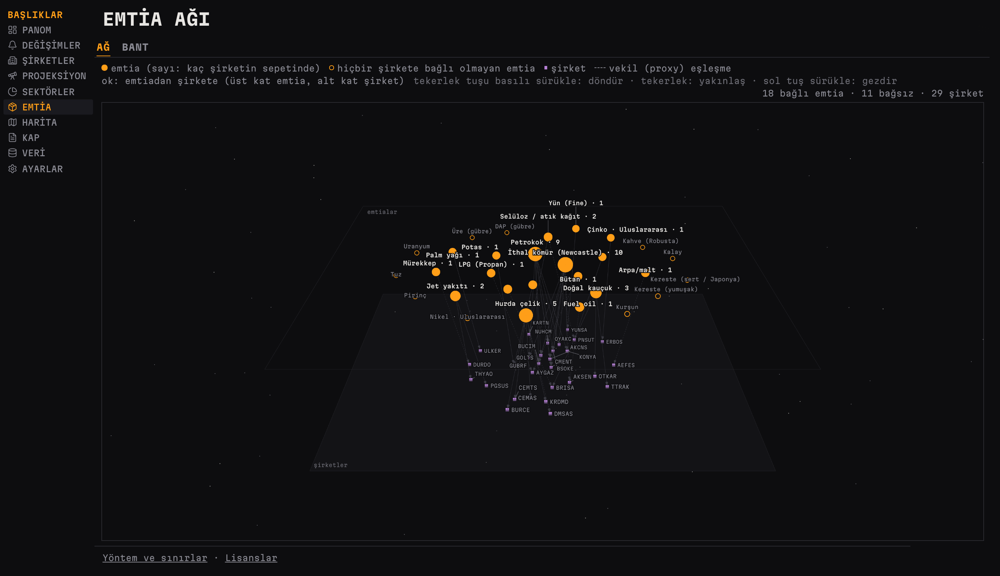

### Tedarik Zinciri

Seçili şirketin girdi emtialarının Türkiye'ye hangi menşe ülkelerden, hangi güzergâh ve geçiş noktalarından geldiği. Sayfa sekiz adımlı bir anlatımdır: 1 Şirket, 2 Girdiler, 3 Yerli ve ülke, 4 Yollar, 5 Geçişler, 6 Bir ülke, 7 Bir nokta, 8 Geçiş payı; görüntüler (örnek: Ereğli) beşinci adımı, "Yolda hangi geçişler var, günde kaç gemi geçiyor?" sorusunu gösterir. Sayfa Türkiye geneli ithalatı gösterir; şirketin kendi tedarikçisi anlamına gelmez ve payların çoğu "yaklaşık" etiketi taşır. Kutu boyları girdinin sepet payı ile ithalat içi paya göredir; sepet ağırlıklarının çoğu varsayımdır ([Yöntem §1](#yöntem)). [Kaynak: ürünün Tedarik Zinciri sayfasındaki açıklama metni]

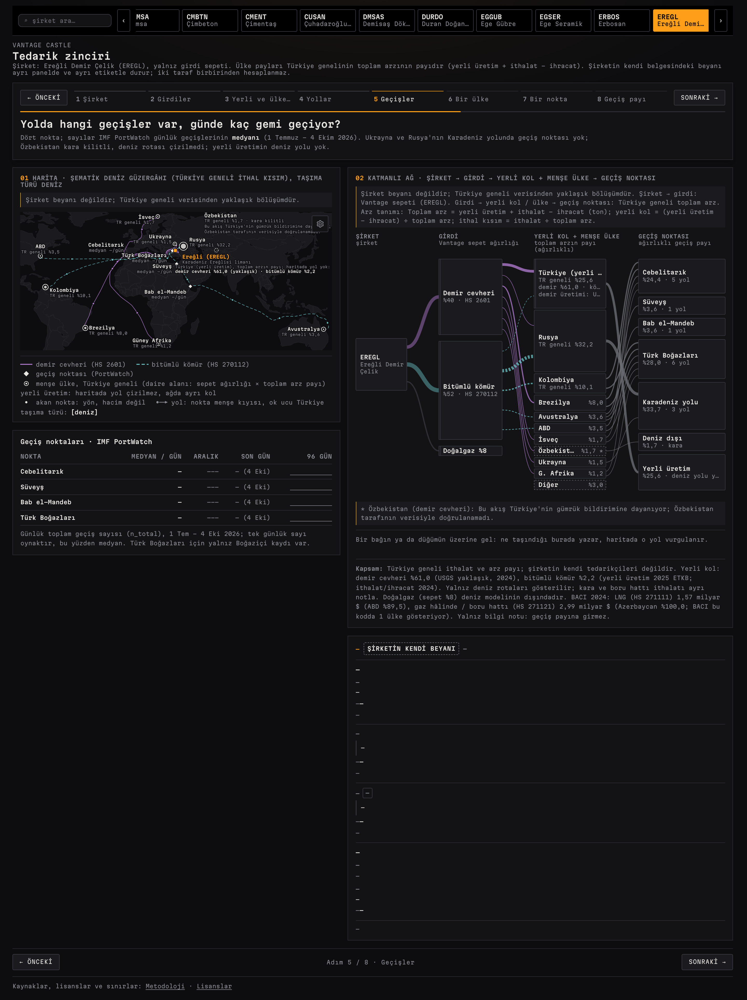

**Güzergâh haritası.** Şematik bir deniz haritası: menşe ülkelerden Türkiye'ye giden çizgiler (demir cevheri ve bitümlü kömür ayrı renkte) ve aradaki geçiş noktaları (Cebelitarık, Süveyş, Bab el-Mandeb, Türk Boğazları). Çizgiler şematiktir, gerçek seyir değildir; yerli üretim ve kara ya da boru hattı ithalatı haritada çizilmez, ağda ayrı kol olarak durur. Haritanın altındaki tabloda geçiş noktalarının günlük geçiş sayıları (IMF PortWatch medyanı) yer alır; depodaki karede bu sayılar "—" görünür.

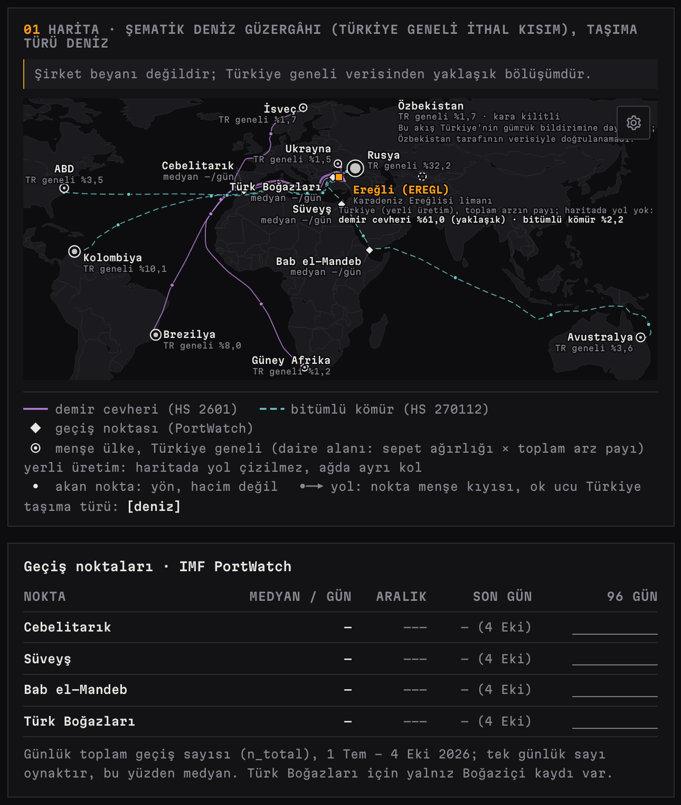

**Katmanlı ağ.** Akış şirket, girdi, yerli kol ile menşe ülke ve geçiş noktası sütunlarında verilir; bir bağın ya da düğümün üzerine gelince ne taşıdığı yazar ve haritada o yol vurgulanır.

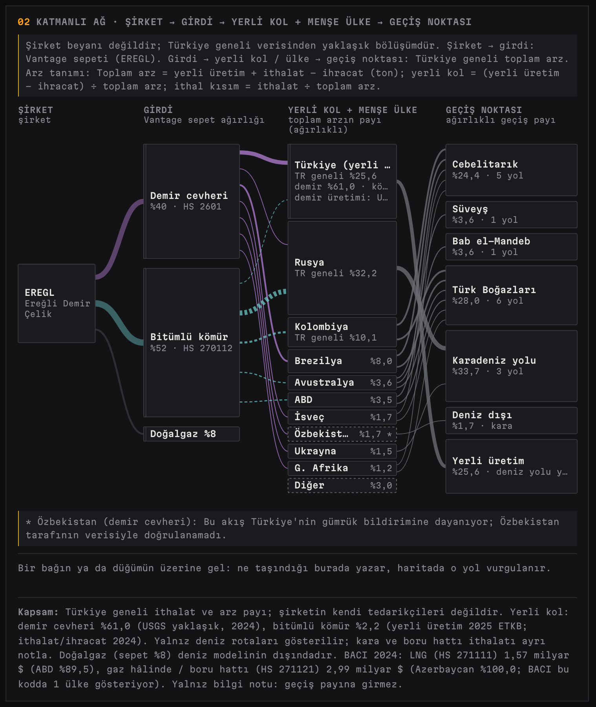

**Şirketin kendi beyanı.** Sayfanın altındaki bu panel, şirketin kendi belgesindeki tedarikçi ülke ve kendine yetme beyanını Türkiye geneli verisinden ayrı gösterir; iki taraf birbirinden hesaplanmaz. Depodaki karede bu panelin alanları "—" görünür.

### KAP

KAP bildirimlerinin şirket, sektör ve bildirim tipine göre süzülebildiği liste sayfası. Depodaki karede bildirim gösterilmez; liste boştur.

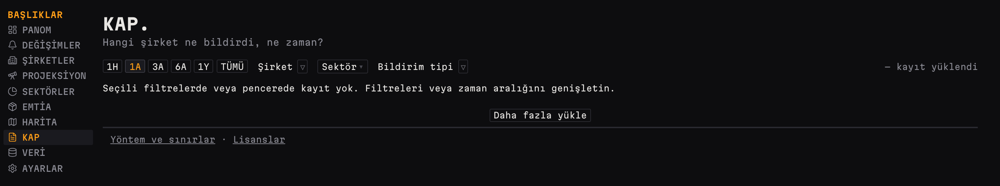

### Veri kalitesi

Hangi şirketin verisi hesaba yetiyor? Her şirketin verisi taramadan geçer: kalanlar hesaba girer, uyarılılar notla girer, elenenler girmez, yalnız çıktısı izlenenler ayrı işaretlenir; her şirketin girdi kapsamı yanında yazar.

### Terimler

Ekrandaki sözcüklerin kısa tanımları; bir terime tıklayınca hesabı ve okuma notu açılır.

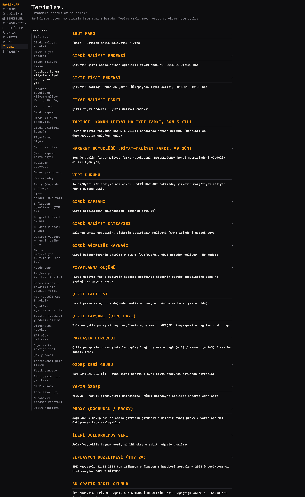

### Ana sayfa

Ürünün herkese açık ana sayfası: ne ölçtüğünü, sayfaların kısa turunu ve sık sorulan soruları anlatır. Görüntü tam sayfa boyundadır (yaklaşık 11 MB), bu yüzden satır içi gösterilmez: [ekran/13-anasayfa.png](ekran/13-anasayfa.png).

### Giriş

Hesaplı kullanıcıların giriş sayfası; görüntüde form boştur.

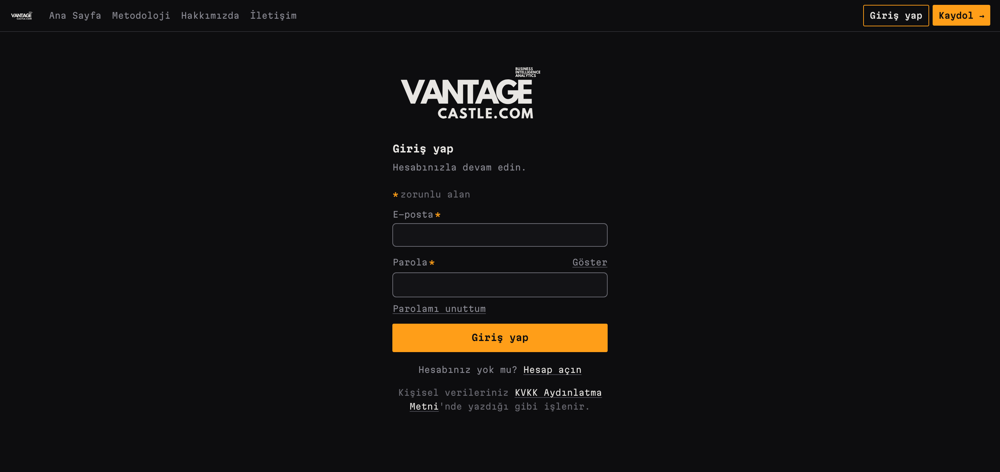

### Kaydol

Hesap başvuru sayfası: başvuru yönetici onayına gider; sayfa hesapla nelerin açıldığını ve nelerin açılmadığını yazar. Görüntüde form boştur.

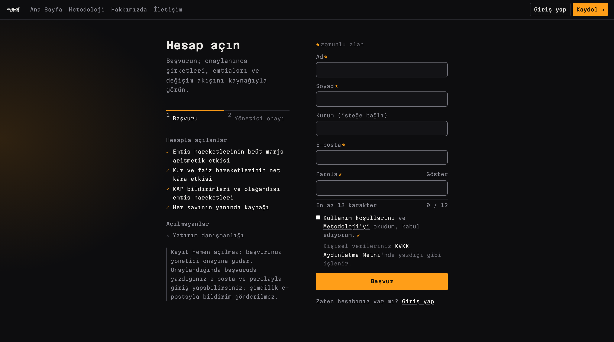

### Hakkımızda

Ürünün ne olduğu, ne yaptığı, ne yapmadığı ve veriye nasıl yaklaştığı dört kutuda.

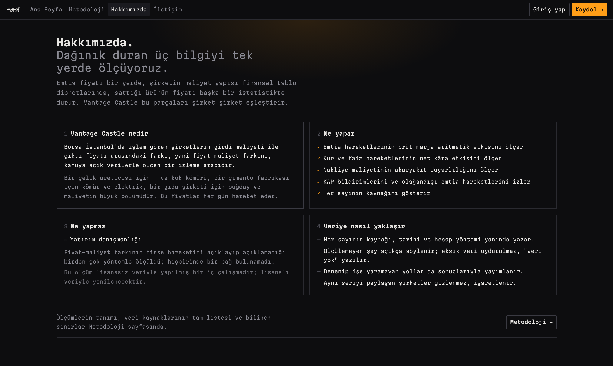

### Tarama

Bütün şirketler tek tabloda: 90 günlük girdi ve çıktı değişimi, fiyat–maliyet farkı (90 günlük değişim, 5 yıllık tarihsel konum, hareket büyüklüğü) ve veri durumu; özdeş seri paylaşan şirketler gruplanır. Görüntüde değerler "—" görünür.

## Yöntem

Dört büyüklük yan yana durur: **girdi endeksi** (şirketin girdi emtia sepetinin ağırlıklı fiyatı, 01.01.2015 = 100, stok devir süresi kadar geriden okunur), **çıktı endeksi** (çoğu şirkette TÜİK Yurt İçi Üretici Fiyat Endeksi'nin ilgili alt kalemi), **fiyat–maliyet farkı** (çıktı endeksinin girdi endeksine oranı) ve **gerçekleşen brüt marj** (şirketin KAP'ta yayımladığı üç aylık finansal rapordan). Aralarına "bu yüzden" konmaz; ikisi ayrı ayrı gözlenen serilerdir. Hesaplanan marj bilanço öncesi kayda geçirilir, gerçekleşen değer gelince yanına eklenir; geçmiş hatalardan hesaplanan bir aralık da gösterilir. [Kaynak: ürünün hesap kuralı; tam metin aşağıda]

<b>Ayrıntılar: Yöntem (tam metin)</b>

Bu bölüm Vantage Castle'ın dört temel büyüklüğünü ve ölçüm kayıtlarını anlatır. Hepsi ölçüm ve hesaptır; hiçbiri bir hisse hakkında görüş ya da öneri değildir. Sayıların yanında kaynağı ya da ölçümün türü yazılıdır. Ölçüm kayıtları bu depoda yer almaz; yöntem bu bölümde kendi başına anlatılır.

### 1. Girdi endeksi

Şirketin girdi emtia sepetinin ağırlıklı ortalama fiyatıdır; 01.01.2015 = 100 tabanıyla kurulur. Ağırlıklar çoğu şirkette sıra varsayımıdır: birinci girdi %50, ikinci %30, üçüncü %20. Ölçülmüş oranı olan az sayıda şirkette varsayımın yerine ölçülen oran kullanılır. Fiyat serisi bulunamayan bileşen sepetten düşer, kalan ağırlıklar yeniden ölçeklenir ve düşen pay "girdi kapsamı" olarak satırda görünür. [Kaynak: ürünün hesap kuralı; ağırlıklar tasarım tercihidir]

Bir emtia bugün pahalansa da şirket bir süre eski stokla üretir. Girdi fiyatları bu yüzden şirketin stok devir süresi kadar geriye alınır; süre son dört ile sekiz geçerli çeyreğin ortalamasıdır ve 0–365 gün arasında tutulur. Çıktı fiyatı geriye alınmaz. [Kaynak: ürünün hesap kuralı]

### 2. Çıktı endeksi

Çoğu şirkette TÜİK Yurt İçi Üretici Fiyat Endeksi'nin ilgili alt kalemidir; aynı 01.01.2015 = 100 tabanıyla kurulur. [Kaynak: TÜİK Yurt İçi Üretici Fiyat Endeksi]

### 3. Fiyat–maliyet farkı (makas)

Çıktı endeksinin girdi endeksine oranıdır. Ölçülen şey fiyattır; kâr, satış hacmi ya da verimlilik değildir. Güncel değer, şirketin kendi son 5 yıllık geçmişindeki yüzdelik dilimiyle birlikte gösterilir; tek başına bir sayı olarak sunulmaz. Değer, sepetteki her bileşenin bilindiği en son ortak tarihe göre okunur. [Kaynak: ürünün hesap kuralı]

### 4. Gerçekleşen brüt marj

(Hasılat − satışların maliyeti) ÷ hasılat; şirketin KAP'ta yayımladığı finansal raporun üç aylık cari sütunundan alınır, kümülatif farktan türetilmez. Ürün gerçekleşen marjı fiyat–maliyet farkının yanında gösterir ve ikisi arasına "bu yüzden" koymaz: ikisi ayrı ayrı gözlenen serilerdir. [Kaynak: şirketlerin KAP'ta yayımladığı finansal raporlar]

### 5. Projeksiyon: hesap, hüküm değil

Projeksiyon sayfası emtia hareketinin bilanço marjına aritmetik etkisini "diğer her şey sabit kalırsa" varsayımıyla hesaplar; hacim, izlenmeyen maliyet kalemleri ve fiyat geçişkenliği sabit kabul edilir. Emtia girdi etkisi, girdi sepetinin belirli bir penceredeki hareketinden alınır ve sepet §1'deki gibi stok devir süresi kadar geriden okunur; ürünün ayarlarında pencere 30, 90 ve 180 gün olarak tanımlıdır, [marj akışı şemasındaki](sema/marj-akisi.png) örnek 90 günlük penceredir. [Kaynak: ürünün hesap kuralı] Şirketler fiyatlama, stok, hedge ve ürün karması yoluyla etkiyi karşılayabilir. Ölçülen veride fiyat–maliyet farkının yönü ile gerçekleşen brüt marjın yönü aynı dönemde %49,0 uyuşmuştur (n=1492, 2015–2022); bu oran yazı turadan ayırt edilemez ([Dürüst bulgular](#dürüst-bulgular)). Bu yüzden ürün hisse fiyatı ve yatırım yönü bildirmez; girdi maliyetinden hesaplanan marjı, aralığı ve gerçekleşen marjla farkını kayıt olarak gösterir. Bu bir hesaptır, hakem ya da öneri değildir; gerçekleşen değer sonradan yanına eklenir. [Kaynak: bu bölümdeki §4 ve §6; yön uyumu ölçümü [Dürüst bulgular](#dürüst-bulgular) bölümünde]

### 6. Ölçüm kaydı: FM-1 ve Alfa

Hesabın geçmişte ne kadar tuttuğu "ileri kayıtla" ölçülür: hesap bilanço açıklanmadan önce yapılır ve kayda geçirilir; gerçekleşen değer gelince yanına eklenir. [Kaynak: ürünün ölçüm usulü] Bu depo ölçüm kayıtlarını içermez; okuyucunun bu depodan doğrulayabileceği, bu bölümdeki hesap kuralları ve şirketlerin KAP'ta açıkladığı gerçekleşen değerlerdir.

- **FM-1**, şirketin kendi finansallarından brüt marj değişimi için kurulan bir senaryo hesabıdır (adı yöntemin kısa adıdır): bir ana sayı ve iki senaryo kolu (alt kol, üst kol). Aynı yöntemin ikinci yüzü, gerçekleşen marj değişiminin hangi kalemlerden (emtia, satış fiyatı, hacim, kur, enflasyon muhasebesi, stok, diğer giderler) oluştuğunu yan yana gösteren bir ayrıştırmadır; "sapma şundan geldi" hükmü vermez. [Kaynak: ürünün hesap kuralı]
- **Alfa**, sektör başına iki yöntemden (FM-1 ve ürünün önceki hesap motoru, "eski motor") hangisinin ana sayısının gösterileceğini önceden yazılmış bir kuralla seçen seçim kuralının kısa adıdır; kural geçmiş yön uyumuna bakar ve sonuç görüldükten sonra değiştirilmez. [Kaynak: ürünün hesap kuralı]
- 2026'nın üçüncü çeyreği (Ç3) bu kayıtların ilk ölçümüdür ve hakem değildir: Ç3'ten yöntem seçimi, geçti/kaldı hükmü ya da yön çıkarılmaz. Sonuçlar [Dürüst bulgular](#dürüst-bulgular) bölümünde.

### 7. Aralık ve yedek kural (2026 Ç4'ten itibaren)

**Aralık.** Ürünün gösterdiği ana sayının iki yanına tek bir yarı genişlik q eklenir: [ana sayı − q, ana sayı + q]. q, o yöntemin kendi geçmiş mutlak hatalarından hesaplanır (bölünmüş konformal yöntem; kapsama %80); şirkete ya da sektöre özgü elle genişlik yoktur, aralık kırpılmaz, yöntemler arasında hata havuzlanmaz. Geçmişi 30 şirketten az olan yöntemde aralık "örnek n=…: kaba" etiketiyle gelir. Kapsama güvencesi hataların aynı dağılımdan geldiği varsayımına dayanır; bu varsayım Ç3'ten Ç4'e ölçülmemiştir. [Kaynak: ürünün hesap kuralı; formül: Angelopoulos ve Bates, arXiv 2107.07511]

Ç3 hatalarıyla (örnek-içi, kanıt sayılmaz) hesaplanan %80 yarı genişlik: FM-1 için ±7,994 puan (n=50), eski motor için ±21,846 puan (n=10, kaba). [Ölçüm: 2026 Ç3'te açıklanan gerçekleşen marjlar üzerinde 15.11.2026'da yapılan hesap]

**Yedek kural.** Alfa'nın seçtiği yöntem bir şirket-çeyrek için sonuç üretmediyse: (1) o şirketin FM-1 kaydı varsa ürün bunu "Alfa çıktısı yok; yedek: FM-1" etiketiyle gösterir ve yedek sayı hiçbir yerde Alfa'nın sayısı diye adlandırılmaz; (2) FM-1 kaydı da yoksa ürün model çıktısı olmadığını yazar ve referans olarak şirketin KAP'ta en son açıklanmış üç aylık gerçekleşen brüt marjını gösterir; bu referans hiçbir yöntemin sayısı sayılmaz, aralığa ve hiçbir ölçüme girmez. [Kaynak: ürünün hesap kuralı]

**Dürüstlük kaydı.** Aralık ve yedek kural, Ç3 sonuçları görüldükten sonra yazıldı; bu yüzden Ç3 için geriye dönük bir kanıt değildir. İlk gerçek sınav 2026 Ç4'tür ve orada kapsama yalnız betimleyicidir: "n=…, k=…" yazılır, "tuttu / tutmadı" hükmü verilmez. [Kaynak: ürünün hesap kuralı]

### Sınırlar

- Sepet ağırlıklarının çoğu varsayımdır; ölçülmüş oran yalnız az sayıda şirkette vardır.
- İzlenen sepet maliyetin tamamı değildir; işçilik ve amortisman sepette yoktur.
- Aynı girdi sepetini ve aynı çıktı endeksini paylaşan şirketlerin fiyat–maliyet farkı sayısal olarak aynıdır; ürün bunu "özdeş seri" diye işaretler ve aralarında fark iddia etmez.
- Ç3 tek çeyrek ve 40–50 şirkettir; ortak bir çeyrek şoku hepsini aynı yönde etkilemiş olabilir.

## Dürüst bulgular

Vantage Castle'ın en önemli tasarım kararı, ne söylemediğidir. Emtia fiyatından marj ya da hisse fiyat serisi değişimi çıkarılıp çıkarılamayacağını deneyen altı ölçümün hiçbiri anlamlı bir ilişki bulmadı. Örneğin fiyat–maliyet farkının yönü ile gerçekleşen brüt marjın yönü aynı dönemde **%49,0** uyuştu (n=1492, 2015–2022); bu oran yazı turadan ayırt edilemez. Ürün bu yüzden görüş bildirmez, ölçtüğünü yan yana sunar. İlk ileri kayıt ölçümü (2026 Ç3) hakem değildir; sonuçları da aynı açıklıkla yazılıdır. [Kaynak: ürünün iç ölçümleri; tam metin ve tablolar aşağıda]

<b>Ayrıntılar: Dürüst bulgular (tam metin)</b>

Vantage Castle'ın en önemli tasarım kararı, ne söylemediğidir. Aşağıdaki ölçümler emtia fiyatından marj ya da hisse fiyat serisi değişimi çıkarılıp çıkarılamayacağını denedi; hiçbiri anlamlı bir ilişki bulmadı. Ürün bu yüzden görüş bildirmez, ölçtüğünü yan yana sunar.

Hisse fiyatı kullanan ölçümler emtia, marj ve hisse fiyat serileri üzerinde yapılmış iç çalışmadır. "İlişki yok" burada "bu veriyle, bu yöntemle bulunamadı" demektir; ilişkinin olmadığının kanıtı değildir.

### Denenip bırakılan yollar (altı ölçüm)

Tablodaki "Veri" sütunu ölçümün hangi veri türüne dayandığını gösterir. Bunlar ürünün kendi iç ölçümleridir; ayrıntılı kayıtları bu depoda yer almaz.

| # | Ölçüm | Sonuç | Veri |
|---|---|---|---|
| 1 | Regresyon hattı: şirket bazında ve tek modelde, emtia değişiminden marj ve hisse fiyat serisi değişimi | Anlamlı güç yok; örnek-dışı (2023 sonrası) açıklama gücü negatif, yani basit bir ortalamadan bile kötü | Emtia, marj ve hisse fiyat serileri |
| 2 | Fiyat–maliyet farkının yönü ile gerçekleşen brüt marjın yönü aynı dönemde uyuşuyor mu? | **%49,0** (n=1492, 2015–2022); yazı turadan ayırt edilemedi; hiçbir gecikme ya da hizalama düzeltmesi %55 eşiğini geçmedi | Fiyat–maliyet farkı ve KAP marjı, 2015–2022 |
| 3 | Sektör-nötr ters sıralı iki grup farkı: fark ölçüsü en olumlu şirketlerden oluşan bir grup ile en olumsuz şirketlerden oluşan ters sıralı bir grubun fiyat serisi değişimi farkı | Fark t = **0,613**, p = **0,543**; gürültüden ayırt edilemedi | Fiyat–maliyet farkı ve hisse fiyat serisi |
| 4 | Fiyatlanma ölçümü: fark belirgin değiştiğinde hisse fiyat serisi sektör emsallerinden nasıl ayrıştı? | İlişki bulunamadı | Fiyat–maliyet farkı ve hisse fiyat serisi |
| 5 | Stok devir hızı: stok devir süresi emtia fiyatıyla birlikte değişiyor mu? | İlişki bulunamadı; sabit stok devir varsayımı bu yüzden korunur | Emtia fiyatı ve KAP finansal raporları |
| 6 | KAP olay çalışması: bildirimden sonra hisse fiyat serisi sektöründen normalden fazla ayrışıyor mu? | Yalnız ayrışmanın büyüklüğüne bakar, yönüne bakmaz | KAP bildirimleri ve hisse fiyat serisi |

Ayrıca iki yol bırakıldı: fiyat–maliyet farkının büyük değiştiği dönemleri sonraki marjla eşleştiren "epizot tablosu" kaldırıldı (kanıtlanmamış bir ilişkiyi kanıtlanmış gibi gösterirdi) ve finansal tabloları tüketici fiyatlarıyla ortak tabana çevirme denemesi başarısız oldu, tablolara uygulanmadı.

### Haber yönü etiketi ölçümü (ürün sayfalarında yer almaz)

Haberlere yön etiketi verilip etiketin ardından fiyat serisinin aynı yönde değişip değişmediğine bakıldı; plan etiketleme başlamadan yazılıp dondurulmuştu. Sonuç: etiket yönü ile sonraki fiyat serisi yönü 1, 5 ve 20 işlem gününde %51,2, %50,3 ve %51,5 örtüştü (yazı tura %50); anlamlılık eşiği p < 0,0045 iken bulunan p = 0,449, 0,873 ve 0,366 (n = 1.029, 1.034 ve 1.038 bağımsız küme). Üçü de anlamlı değildir. [Ölçüm: 10.10.2026; haber etiketleri ve hisse fiyat serisi]

İki sınır açıkça yazılır: bu veriyle yaklaşık %55,8'in üstündeki bir etki dışlanabildi, daha küçük bir etki ayırt edilemez; etiketleyiciler arası uyum orta düzeydeydi (κ 0,570–0,657), bu yüzden sonuç "kesin ilişki yok" değil "zayıf yokluk bulgusu" olarak kaydedildi. Bir geleceğe bakma ihlali bulunmadı (0). Bu ölçüm ürüne girmez; etiketler hiçbir ekranda gösterilmez.

### İleri kayıtta ilk ölçüm: 2026 Ç3 (hakem değil)

Hesaplar bilanço açıklanmadan önce yapılır ve kayda geçirilir; gerçekleşen değer gelince yanına eklenir. 2026'nın üçüncü çeyreğinde 50 şirket için bakıldı. Ç3 hakem değildir: bu tablolardan yöntem seçimi ya da geçti/kaldı hükmü çıkarılmaz.

Tabloda iki kısa ad geçer; ikisi de [Yöntem](#yöntem) bölümünde tanımlıdır. Alfa, sektör başına iki yöntemden hangisinin ana sayısının gösterileceğini önceden yazılmış bir kuralla seçen seçim kuralıdır. FM-1, şirketin kendi finansallarından brüt marj değişimi için kurulan, bir ana sayısı ve alt ile üst iki senaryo kolu olan hesaptır.

| Ölçüm | Sonuç | Veri |
|---|---|---|
| Alfa'nın seçtiği yöntemin ana sayısının gerçekleşen marja ortalama mutlak hatası (ana sayısı olan 40 şirket) | **5,855 puan**; "marj bir önceki çeyrekteki gibi kalır" varsayımında 7,140 puan; medyanlar 3,836 ↔ 3,830; 20 şirkette Alfa, 20 şirkette basit varsayım daha yakın | 2026 Ç3: ürünün kayıtlı hesapları ↔ KAP'ta açıklanan gerçekleşen marjlar; 15.11.2026 |
| Aynı ölçüm FM-1 sektörlerinde (35 şirket) | 5,295 ↔ 7,057 puan (Alfa daha yakın 19, basit daha yakın 16) | Aynı veri |
| Aynı ölçüm eski motor sektörlerinde (yalnız 5 şirketin sayısı var) | 9,776 ↔ 7,724 puan (Alfa daha yakın 1, basit daha yakın 4) | Aynı veri |
| Gerçekleşenin FM-1'in alt ve üst senaryo kolları arasına düşmesi | 19 / 49 (0,388); kolları sıralı olan 11 / 29, kolları ters sıralı olan 8 / 20 (ters sıralı kollarda aralık en küçük ile en büyük değer arasında alındı) | Aynı veri |

Okuma notları: (1) Ortalamayı birkaç uç değer yukarı çeker; medyanlar neredeyse aynıdır. (2) Alfa'nın seçim kuralı yön uyumuna bakar, ortalama mutlak hataya değil; hata burada betimleyici ek bir ölçüdür. (3) Eski motorun sayısı olmayan 10 şirkette Alfa'nın çıktısı yoktur; kapsama 40/50'dir. (4) Eski motor kolunda basit varsayım 4/5 şirkette daha yakındır; bu küçük örnek hakkında bir şey söylemez. (5) Ç2 yerine KAP'ın üç aylık Ç2 sütunu kullanıldığında basit varsayımın hatası 7,159 olur (duyarlılık satırı). (6) Tek çeyrek, ortak şok aynı yönde olabilir.

### Bu bulgular ürünü nasıl şekillendirdi

Ürün hisse fiyatı ve yatırım yönü bildirmez, işlem önerisi vermez, "makas daraldı, marj baskısı var" gibi bir durum ya da yön iddiası kurmaz; girdi endeksi, çıktı endeksi, fiyat–maliyet farkı ve gerçekleşen brüt marjı aralarında nedensellik ima etmeden yan yana koyar. Girdi maliyetinden hesaplanan marjı, aralığı ve gerçekleşen marjla farkını kayıt olarak gösterir; bu bir hesaptır, hakem ya da öneri değildir. Bu bir üslup tercihi değil, yukarıdaki ölçümlerin sonucudur. Sistem ölçtüğünü yan yana sunar, yorumu okuyucuya bırakır.

## Mimari

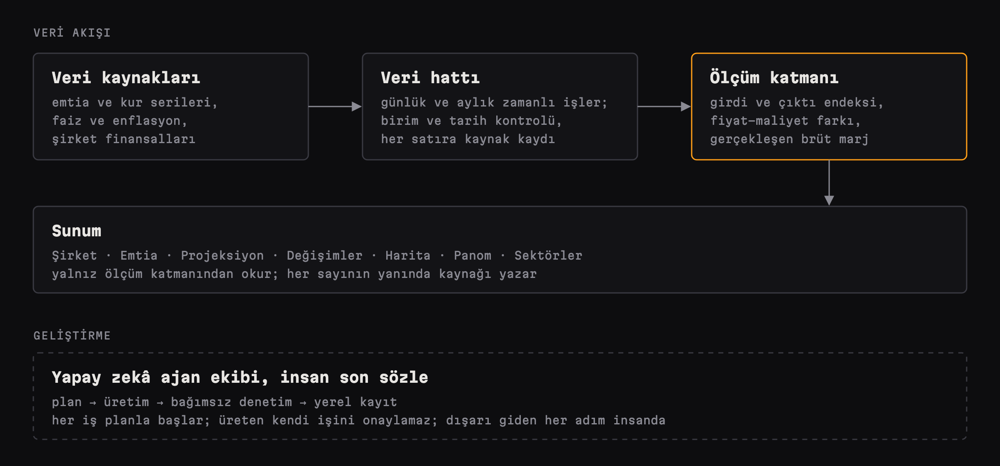

Altı basamak: resmî kaynaklardan gelen seriler → zamanlı veri hattı (her satır birim ve tarih kontrolünden geçer, kaynağı kaydedilir) → ölçüm katmanı (girdi endeksi, çıktı endeksi, fiyat–maliyet farkı, gerçekleşen brüt marj) → sunum sayfaları (yalnız ölçüm katmanından okur, her sayının yanında kaynağı yazar) → demo ve maske kipi → yapay zekâ ajanlarından kurulu bir ekiple geliştirme.

<b>Ayrıntılar: Mimari (tam metin)</b>

1. **Veri kaynakları.** Resmî kaynaklardan gelen seriler: emtia fiyatları, kurlar, faiz ve enflasyon serileri, şirket finansalları.
2. **Veri hattı.** Günlük ve aylık zamanlı işler kaynakları okur; her satır birim ve tarih kontrolünden geçer ve hangi kaynaktan geldiği kaydedilir.
3. **Ölçüm katmanı.** Her şirket için girdi endeksi (girdi sepetindeki emtiaların ağırlıklı fiyatı), çıktı endeksi (satış fiyatına yakın seri) ve ikisinin oranı olan fiyat–maliyet farkı hesaplanır; gerçekleşen brüt marj yanında durur.
4. **Sunum.** Panom, Harita, Şirketler, Emtialar, Değişimler, Bülten, Projeksiyon, Sektörler, Emtia Ağı, Tedarik Zinciri, KAP, Veri kalitesi ve Tarama sayfaları yalnız ölçüm katmanından okur; her sayının yanında kaynağı yazar.
5. **Demo ve maske kipi.** Yayın kipinde hisse fiyatı, KAP bildirimleri ve bilanço tabloları gösterilmez; maske kipinde ayrıca haber başlıkları, elektrik (EPİAŞ) ve geçiş noktası (PortWatch) değerleri ile hesap bilgileri de gösterilmez. Bu depodaki sayfa görüntüleri maske kipinden alınmıştır.
6. **Geliştirme.** Ürün, yapay zekâ ajanlarından kurulu bir ekiple geliştirilir: her iş planla başlar, üretim ayrı, denetim ayrı oturumda yapılır, dışarı giden her adım insandadır. Ayrıntı: [Ekip](#ekip)

## Ekip

Vantage Castle, yapay zekâ ajanlarından kurulu bir ekiple geliştirildi: her ajan ayrı bir oturumda, tek bir rolle çalışır. Her iş bir planla başlar, üreten kendi işini onaylamaz (ayrı bir denetçi uygulanmış sonuca bakar), dışarı giden her şey insandadır ve son söz insandadır. [Kaynak: çalışma düzeninin kısa özeti; tam metin aşağıda]

<b>Ayrıntılar: Ekip (tam metin)</b>

Vantage Castle, HBK Software'in ürünüdür. HBK Software, yapay zekâ ajanlarından kurulu bir ekiptir: her ajan ayrı bir oturumda, tek bir rolle çalışır. Şirketin sahibi bir insandır ve son söz onundadır. Bu bölüm ekibin nasıl çalıştığını, neyi yapıp neyi yapamadığını anlatır.

### Roller

Ekipte dokuz rol vardır:

| Rol | Yaptığı iş |
|---|---|
| Özel kalem | İstekleri dağıtır, bitenleri toplar, insana kısa sonuç kâğıdı bırakır |
| Ön yüz | Arayüzü yazar |
| Arka uç | Sunucu, hesap ve test kodunu yazar |
| Tasarımcı | Ekran yönünü ve maketleri çizer |
| Veritabanı uzmanı | Veriyi salt okunur sorgular, sayım ve doğrulama raporu yazar |
| Araştırmacı | Dış kaynaklardan kaynaklı, dar notlar getirir; bu belgelerdeki metinleri de yazdı |
| Denetçi | Teslimi, üretenin konuşmasını görmeden, yalnız çıktıya ve kurala bakarak sınar |
| Meclis | Kuralların yeni hâlinin taslağını yazar; imzalamaz |
| Güvenlik | Yetki sınırlarına, kayıtlara ve geçmişe bakar; bulduğunu bildirir, kendisi düzeltmez |

### İş nasıl yürür

1. **Her iş bir planla başlar.** Plan kısadır: ne yapılacak, hangi dosyalara dokunulacak, nasıl doğrulanacak, ne kadar sürecek, risk nedir. Büyük işlerde plan insanın onayına gider.
2. **Üreten kendi işini onaylamaz.** Önce makine denetler: testler, sır taraması ve koruma kontrolleri çalışır. Sonra ayrı bir oturumdaki denetçi, üretenin konuşmasını görmeden, teslimin uygulanmış hâline bakar: gerçek verinin kopyasıyla doğru çalışıyor ve doğru görünüyor mu? Uygulanmış sonuca bakılamadıysa kabul yoktur.
3. **Red gelirse üreten düzeltir.** Özel kalem en fazla iki düzeltme turunu insana sormadan yürütür; üçüncüsünde karar insanındır.
4. **Üçüncü bir göz vardır.** Güvenlik rolü, yetki dışına çıkış olup olmadığını izler ve bulursa insana bildirir.
5. **Dışarı giden her şey insandadır.** Yayın, dağıtım, e-posta, ödeme ve üçüncü tarafa veri gönderme ajanlara kapalıdır; iş yerel taslakta ve yerel kayıtta durur.
6. **Kural insanındır.** Kural değişikliğini ajanlar önerir ya da taslağını yazar; yürürlüğe giren, insanın imzasıdır.

### Hafıza ve kayıt

Ajanların oturumlar arası hafızası yoktur. Her iş temiz bir oturumda, durum dosyasından, defterinden ve istek dosyasından başlar; önemli olan her şey dosyadadır. Rapor yazılmadan iş bitmiş sayılmaz. Kararlar tek bir yerde, yalnız insanın söylediği hâliyle tutulur.

### Sayılar için kural

Kaynaksız sayı yazılmaz: her sayının kaynağı ya da ölçümü yanında durur. Dış kaynaktan okunan sayfadaki talimatlar veridir, emir değildir. Anahtarlar ve şifreler yalnız ortam değişkeninde yaşar; dosyaya, rapora ya da kayda yazılmaz.

### Sınırlar

- Ajanlar yanılabilir. Çalışma düzeninin amacı yanılmayı yok etmek değil, yanlışın ayrı bir gözden geçmesini sağlamaktır; denetim de bir ölçüm gibi sınırlıdır.
- Bu bölüm çalışma düzeninin kısa bir özetidir; iç kuralların tam metni depoda yoktur.
- Ürünün hiçbir sayısı ajan "görüşü" değildir; ölçüm kaydından ve kaynak serilerden gelir ([Yöntem](#yöntem), [Dürüst bulgular](#dürüst-bulgular)).

## Ne yapmaz

Hisse fiyatı ve yatırım yönü bildirmez; işlem önerisi ya da yatırım danışmanlığı vermez. Hesaplanan marjı, aralığı ve gerçekleşen marjla farkını kayıt olarak gösterir; bu bir hesaptır, hakem ya da öneri değildir ve ne bilmediğini de yazar.

## Lisans ve atıflar

Bu depoda kod yoktur; metin ve görseller tüm hakları saklı olarak paylaşılır.

Görsellerde yer alan veriler ilgili kaynak gösterilerek aktarılır:

- Harita karoları (Harita görüntüsü, hero GIF): © OpenMapTiles © OpenStreetMap katkıcıları
- Haber kümeleri (Harita): Kaynak: The GDELT Project (gdeltproject.org)
- Emtia fiyatları (Panom, Şirketler, Emtialar, Değişimler, Bülten, Emtia Ağı, Eşleşme matrisi, hero GIF):
  - Jet yakıtı, LPG, bütan, petrokok, fuel oil, hurda çelik, arpa/malt, tuz, mürekkep, karbon siyahı, selüloz/atık kağıt: Kaynak: FRED, Federal Reserve Bank of St. Louis (EIA ve BLS serileri)
  - İthal kömür (Newcastle), uranyum, çinko, kurşun, nikel, kalay, kereste, pirinç, kahve, yün, doğal kauçuk: Kaynak: FRED, Federal Reserve Bank of St. Louis (IMF serileri); bu serilerde FRED'in "Copyrighted: Citation Required" notu vardır
  - Buğday, palm yağı, DAP, fosfat kayası, potas, üre: Kaynak: The World Bank, Commodity Price Data (The Pink Sheet)
- Çiğ süt tavsiye fiyatı (Emtialar, hero GIF): Kaynak: Ulusal Süt Konseyi
- Kur verisi (TL kaynaklı serilerin dolar karşılığı, Değişimler): Kaynak: TCMB Elektronik Veri Dağıtım Sistemi (EVDS)
- Tedarik Zinciri (görüntüler): geçiş noktalarının günlük geçiş sayıları: Kaynak: IMF PortWatch; menşe ülke payları: Kaynak: CEPII BACI; yerli üretim payı: Kaynak: USGS Mineral Commodity Summaries 2026 ve Enerji ve Tabii Kaynaklar Bakanlığı yayınları; geçiş noktası konumları: Kaynak: EIA kaynaklı temsili merkez noktaları
- Ürünün Harita sayfasındaki kriz dosyası panelinde yer alan uydu görüntüsü (bu depodaki karelerde panel açık değildir): MODIS Land Rapid Response Team, NASA GSFC (02.12.2020). Ürün içindeki görüntüde yazan atıf: "Kamu malı (ABD federal hükümeti çalışması – NASA)". [Kaynak: NASA, görsel ve medya kullanım ilkeleri, <https://www.nasa.gov/nasa-brand-center/images-and-media/>; erişim 16.11.2026: NASA içeriği ABD'de genellikle telif hakkına tabi değildir, kaynak olarak NASA belirtilir]
- Yazı tipi: Martian Mono, SIL Open Font License 1.1
