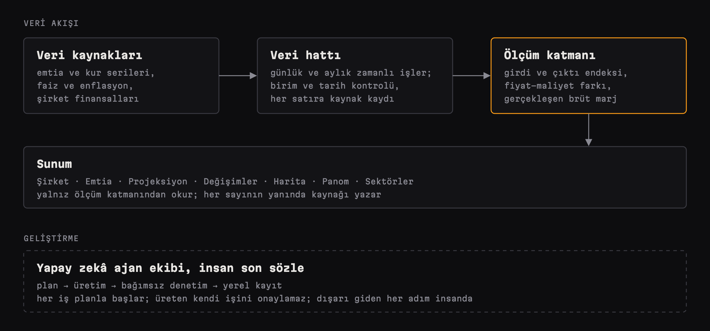

# Architecture

The diagram labels are in Turkish; this page explains them.

1. **Data sources (Veri kaynakları).** Series with a stated source: commodity prices, exchange rates, interest and inflation series, company financials.
2. **Data pipeline (Veri hattı).** Daily and monthly scheduled jobs read the sources; every row passes unit and date checks and its source is recorded.
3. **Measurement layer (Ölçüm katmanı).** For each company the input index (weighted price of the commodities in its input basket), the output index (a series close to its sales price) and their ratio, the price–cost gap, are calculated; the realised gross margin sits next to them.
4. **Presentation (Sunum).** The My board, Map, Companies, Commodities, Changes, Bulletin, Projection, Sectors, Commodity Network, Supply Chain, KAP, Data quality and Screening pages read only from the measurement layer and show the source next to every number.
5. **Demo and masked mode.** In publication mode share prices, KAP filings and financial statement tables are not shown; in masked mode news headlines, electricity (EPİAŞ) and chokepoint (PortWatch) values and account details are also left out. The page images in this repository come from the masked mode.
6. **Development (Geliştirme).** The product is built by a team of AI agents: every task starts with a plan, production and review happen in separate sessions, and every outward step is taken by a human. Details: [team.md](team.md)
