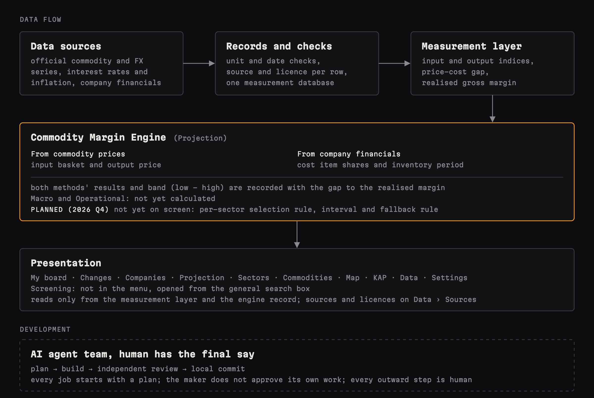

# Architecture

Planned features in the diagram are marked "PLANNED (2026 Q4)".

1. **Data sources.** Series with a stated source: commodity prices, exchange rates, interest and inflation series, company financials. The sources of the data shown in this repository's images are written in the [Licence and attributions](../README.en.md#licence-and-attributions) section; the product's Sources (Kaynak) page also shows each series' institution, licence and last observation.
2. **Record and check layer.** Every row passes a unit and date check and the source it came from is recorded.
3. **Measurement layer.** For each company, the input index (the weighted price of the commodities in the input basket), the output index (a series close to the selling price) and their ratio, the price–cost gap, are calculated; the realised gross margin stands beside them.
4. **Commodity Margin Engine.** It turns the series in the measurement layer and the company's financials into the Projection calculation: two methods and a band. An interval calculated from past errors and a fallback rule are planned from the fourth quarter of 2026 and are not yet on screen. The methods are written and recorded before the financial statement is published; a recorded calculation does not change afterwards, and the realised value is added beside it ([Commodity Margin Engine](method.md#commodity-margin-engine)).
5. **Presentation.** The My board, Changes, Bulletin, Companies, Projection, Sectors, Commodities, Commodity Network, Map, Supply Chain, KAP, Sources, Data quality, Terms, Settings and Screening pages read only from the measurement layer and the engine's record; sources and licences are written on the Data › Sources page. In the publication mode share prices, KAP filings and financial statement tables are not shown; in the masked mode news headlines, electricity (EPİAŞ) and chokepoint (PortWatch) values, and account details are also not shown. In demo mode KAP, the Sectors margin page and Projection · Realised are not listed in the menu. The page images in this repository were taken in the masked mode. [Source: the product's menu definition, 17.11.2026]
6. **Development.** The product is developed by a team made up of AI agents: every job starts with a plan, production and review happen in separate sessions, and every step that goes outside is in human hands. Details: [Team](team.md)
