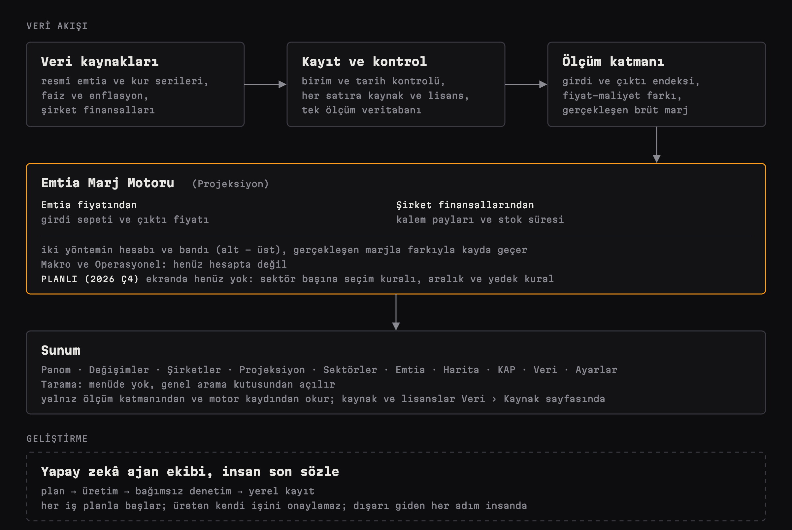

# Mimari

Şemada planlı özellikler "PLANLI (2026 Ç4)" etiketiyle işaretlidir.

1. **Veri kaynakları.** Kaynağı belirtilen seriler: emtia fiyatları, kurlar, faiz ve enflasyon serileri, şirket finansalları. Bu depodaki görsellerde yer alan verilerin kaynakları [Lisans ve atıflar](../README.md#lisans-ve-atıflar) bölümünde yazılıdır; ürünün Kaynak sayfası her serinin kurumunu, lisansını ve son gözlemini ayrıca gösterir.
2. **Kayıt ve kontrol katmanı.** Her satır birim ve tarih kontrolünden geçer ve hangi kaynaktan geldiği kaydedilir.
3. **Ölçüm katmanı.** Her şirket için girdi endeksi (girdi sepetindeki emtiaların ağırlıklı fiyatı), çıktı endeksi (satış fiyatına yakın seri) ve ikisinin oranı olan fiyat–maliyet farkı hesaplanır; gerçekleşen brüt marj yanında durur.
4. **Emtia Marj Motoru.** Ölçüm katmanındaki serileri ve şirketin finansallarını Projeksiyon hesabına çevirir: iki yöntem ve bant. Geçmiş hatalardan hesaplanan aralık ile yedek kural 2026'nın dördüncü çeyreğinden itibaren planlıdır ve ekranda henüz yoktur. Yöntemler bilanço açıklanmadan önce yazılıp kayda geçirilir; kayıtlı hesap sonradan değişmez, gerçekleşen değer yanına eklenir ([Emtia Marj Motoru](yontem.md#emtia-marj-motoru)).
5. **Sunum.** Panom, Değişimler, Bülten, Şirketler, Projeksiyon, Sektörler, Emtia, Emtia Ağı, Harita, Tedarik Zinciri, KAP, Kaynak, Veri kalitesi, Terimler, Ayarlar ve Tarama sayfaları yalnız ölçüm katmanından ve motorun kaydından okur; kaynak ve lisanslar Veri › Kaynak sayfasında yazılıdır. Yayın kipinde hisse fiyatı, KAP bildirimleri ve bilanço tabloları gösterilmez; maske kipinde ayrıca haber başlıkları, elektrik (EPİAŞ) ve geçiş noktası (PortWatch) değerleri ile hesap bilgileri de gösterilmez. Demo kipinde KAP, Sektörler'in marj sayfası ve Projeksiyon·Gerçekleşen menüde listelenmez. Bu depodaki sayfa görüntüleri maske kipinden alınmıştır. [Kaynak: ürünün menü tanımı, 17.11.2026]
6. **Geliştirme.** Ürün, yapay zekâ ajanlarından kurulu bir ekiple geliştirilir: her iş planla başlar, üretim ayrı, denetim ayrı oturumda yapılır, dışarı giden her adım insandadır. Ayrıntı: [Ekip](ekip.md)
